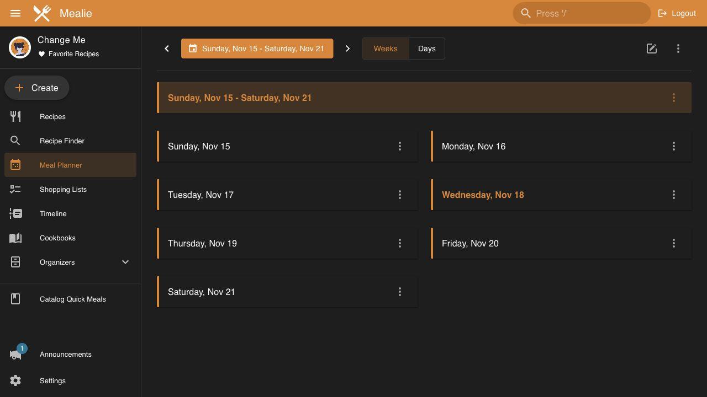
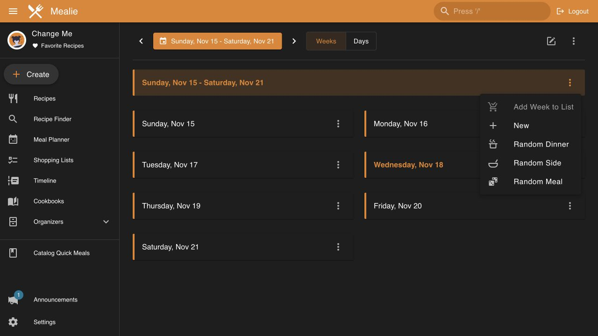
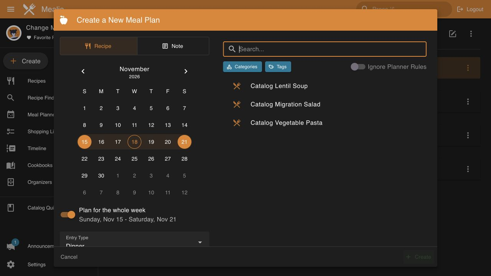
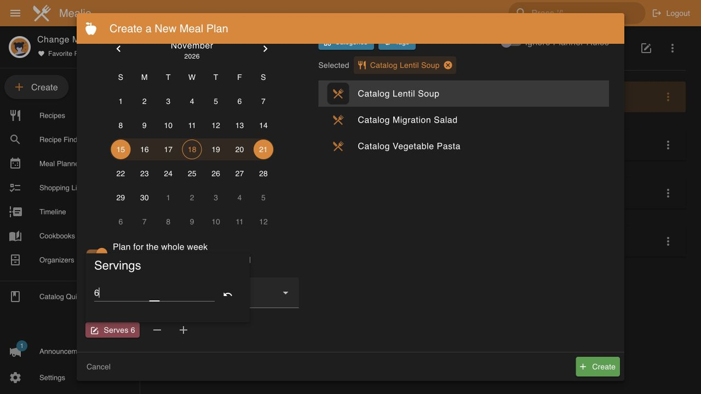
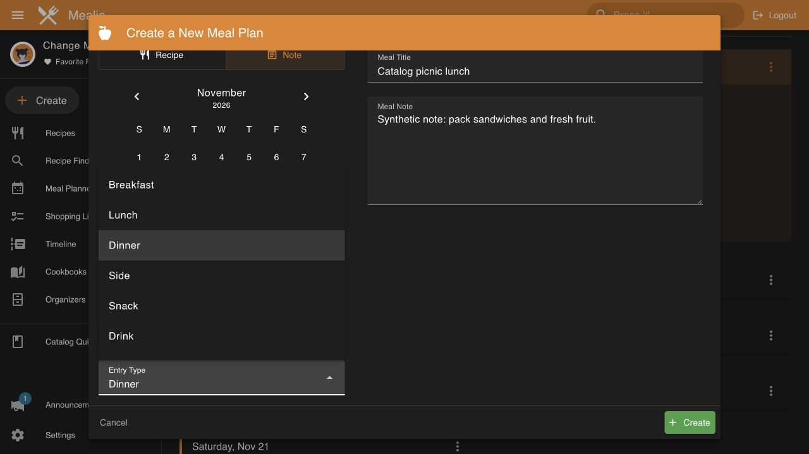
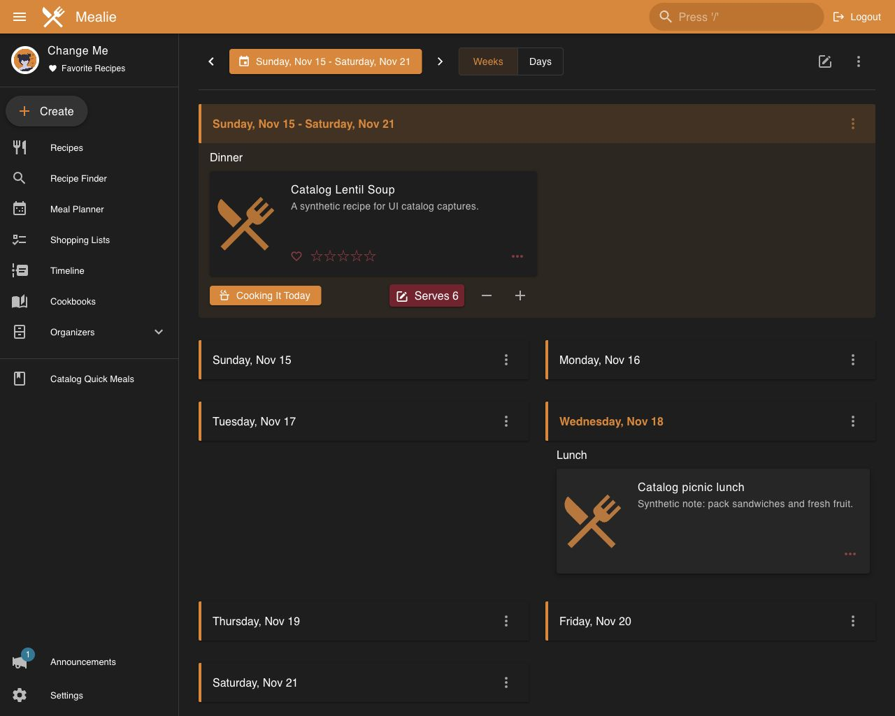
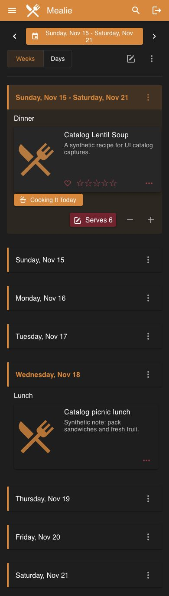
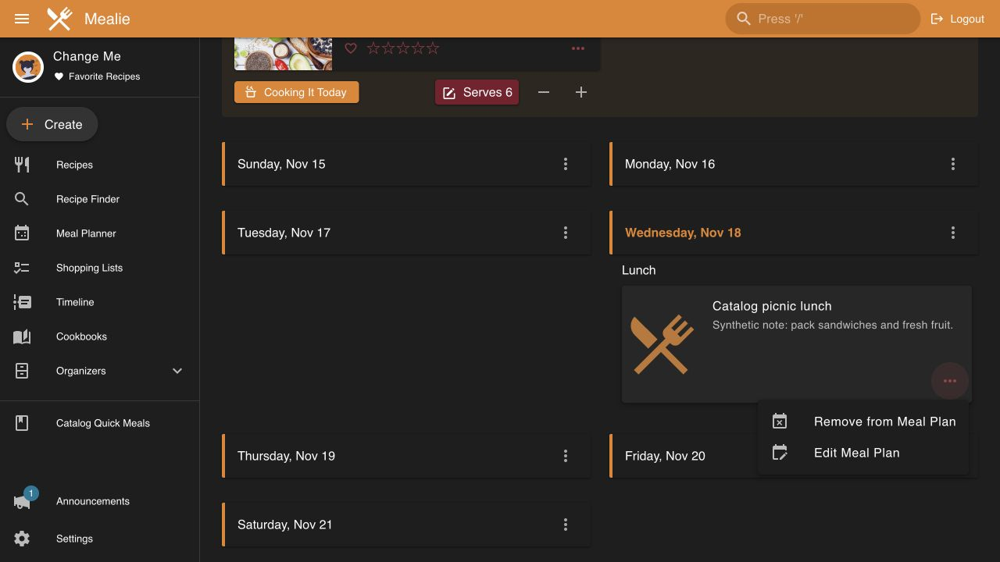
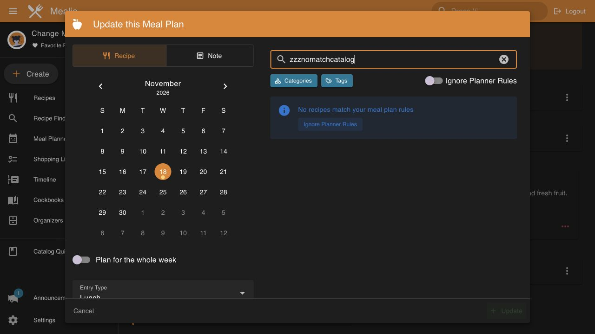
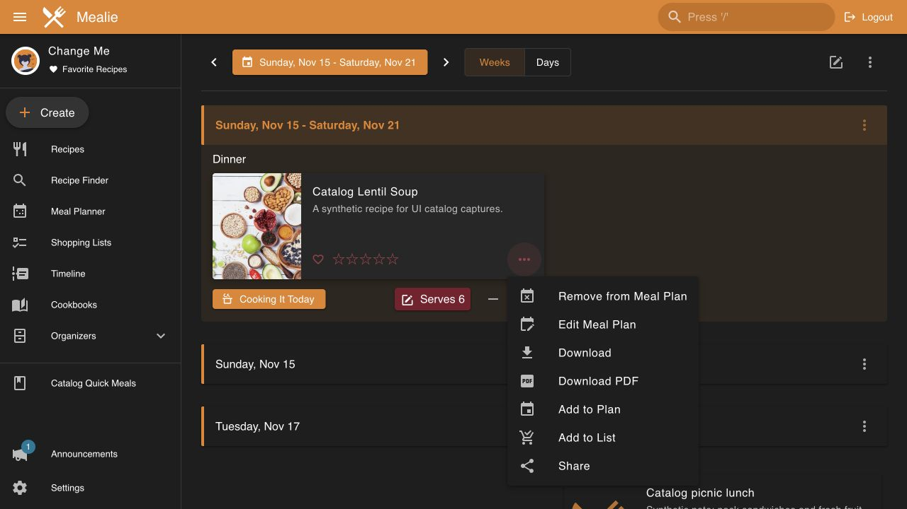

# Meal planner view

Route: `/household/mealplan/planner/view`. Source: [view.vue](../../frontend/app/pages/household/mealplan/planner/view.vue).

## Functions

- Render the parent planner's week/day groups. Keep [shared meal-plan functions](../shared-meal-plan.md) and [parent toolbar](household--mealplan--planner.md).
- Present each meal under its localized type. Recipe cards include name, description, image, tags, rating, favorite, scaled link, and context menu.
- Preserve [shared recipe card actions](../shared-recipe-actions.md) plus leading Remove from Plan and Edit Meal Plan actions.
- Note entries show title and text with a separate menu containing Remove from Plan and Edit Meal Plan.
- Edit opens the shared entry dialog with existing data. Create/update use parent actions. Ignore entries with missing entryType when opening Edit.
- Remove calls delete directly and refreshes on success. The source has no confirmation dialog for this action.
- Show Cooking It Today only for week entries. It moves that entry to today's local date and clears endDate.
- Show editable servings for recipe entries. Preserve 400ms save debounce, pending edit protection, and scope-disposal flush.
- Keep header New, random, and Add Day/Week to List actions, including disabled empty-list state.
- Keep responsive card width and week grid. Day columns must not clip the nested recipe menu on narrow screens.

## Screenshots

### Note menu and rule-filtered empty selector

## Migration validation

- [ ] Verify Cooking It Today, removal, update failures, and scaled list ingredients during replacement.

## Redesign (implemented)

See the redesign table in [the planner page](household--mealplan--planner.md#redesign-implemented): View and Edit are now the same board.

## Shadcn Vue replacement checklist

- [ ] Use semantic meal sections, Cards, DropdownMenu, shared entry Dialog, serving Popover, and Buttons.
- [ ] Preserve notes, scales, plan actions, rule filtering, week-to-day scheduling, and responsive menu access.
