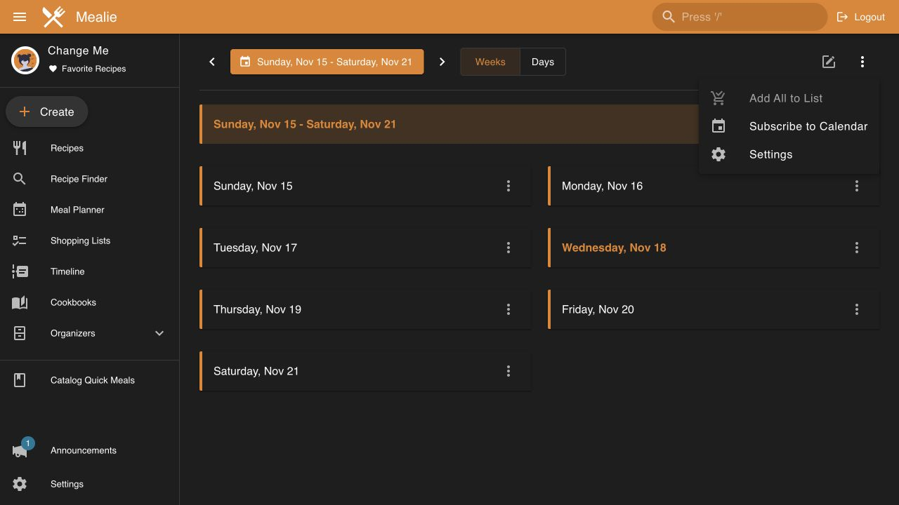
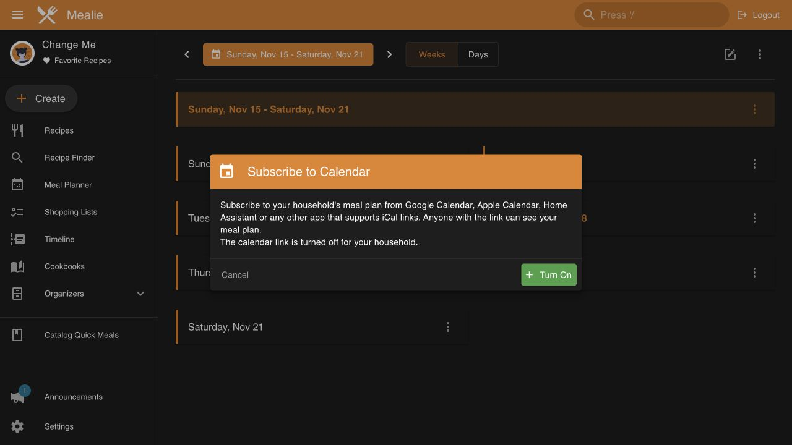

# Meal planner parent and toolbar

Route: `/household/mealplan/planner`. Source: [planner.vue](../../frontend/app/pages/household/mealplan/planner.vue).

## Functions

- Require authentication. Redirect the bare parent route to View and preserve query parameters.
- Share the toolbar, API state, and date range across View and Edit. Preserve [all shared meal-plan behavior](../shared-meal-plan.md).
- Refresh household preferences on entry so a changed first day of week takes effect within the same browser session.
- Read start/end from query parameters. Invalid ISO values fall back to the configured default range.
- Weeks mode rounds the sorted range to complete household weeks. Days mode uses the exact selected days.
- Leave a half-selected calendar range available for the second click. Normalize a completed weekly selection to full weeks.
- Previous/Next moves by the number of currently visible calendar days, not a fixed seven-day interval.
- The range popover contains the calendar and mode-specific default past-count and count controls. Minimum counts are zero past and one current/future.
- Persist day and week count preferences. Switching modes resets the range from that mode's defaults.
- Update start/end query parameters with local yyyy-MM-dd values. Preserve other query parameters and the active child route.
- Show Weeks/Days toggle. In Days mode, badge Weeks with the number of hidden week entries and explain the count in a tooltip.
- Keep View/Edit navigation and its query parameters. Menu actions include Add All to List, Subscribe to Calendar, and Settings.
- Add All uses visible recipe entries with their scales. Disable it when none exist. Days mode excludes hidden week entries from this action.
- Settings opens meal-plan rules. Calendar opens the shared feed dialog. Render the child route with current plans and actions.
- Group week entries by their stored dates. Retain a separate week row if older entries have different week boundaries.

## Screenshots

## Migration validation and optional evidence

These additional cases remain for replacement validation. See the [handoff evidence decisions](../HANDOFF.md#evidence-decisions) for shared references, preview fixtures, and unexecuted branches.

- [ ] Verify reversed/invalid dates, multiple-week ranges, DST transitions, and changed household week start during replacement.
- [ ] Verify enabled calendar-feed controls with an approved disposable credential fixture; do not expose a real feed token in artifacts.

## Redesign (implemented)

View and Edit are one planner board now; both routes still open it, so existing links keep working. Changes users will notice:

| Before | Now |
| --- | --- |
| Separate View (cards) and Edit (drag-and-drop line items) pages behind a View/Edit toggle. | One board. On desktop each week is a grid: days across, meal types down (Breakfast, Lunch and Dinner always; Side, Snack, Drink and Dessert once a meal uses them), with a "This week" row of whole-week entries on top. Phones and tablets get the same plan as a list of day cards grouped by meal type. |
| Drag in Edit moved a meal to another day or week; its meal type was changed from a chip menu. | Drag a meal to any cell: it moves to that day and meal type in one step (or onto the week row). Dragging uses pointer events, so mouse, touch (after a short press) and pen behave the same. The meal type can still be changed in the entry dialog. |
| "New" and random-meal buttons per day; "Add day to list" in a menu. | A "+" in every cell opens the entry dialog with that day and meal type already chosen (empty cells show it, filled cells on hover). Each day's ⋮ menu has Add day to list and Random meal by type; the week row has "Add for the week" and its own ⋮ (Add week to list, random by type). |
| Recipe cards with description, tags and rating; notes in their own cards; servings stepper under each card. | Compact meal cards: photo and name (with a × scale badge when the servings differ) in the grid, a wider row with the servings stepper in the day list. Notes show an icon, title and text. |
| Recipe card menu (full recipe actions) with Remove/Edit at the top; notes had a separate small menu; Randomize lived only in Edit. | Every meal's ⋮ starts with Edit meal plan, Randomize recipe, Cooking it today (whole-week entries only) and Remove from meal plan; recipe meals then offer Add to list, Share and group recipe actions. |
| Toolbar: range button with a Vuetify date picker, Weeks/Days toggle, View/Edit and a ⋮ (Add all to list, Calendar feed, Settings). | Title, ‹ range › with a Today button, the range popover (the new calendar plus the past/count settings), Weeks/Days (the hidden week-entry count stays as a badge), an "Add all to list" button and a ⋮ for Calendar feed and Settings. The range reads "Nov 15 – Nov 21". |
| Range picker: Vuetify range calendar. | Click a first day and then a last day; Weeks mode still rounds to whole weeks. |
| Calendar feed dialog with Vuetify chips, time fields and a URL field. | Meal-type toggle chips, Include notes, a time box per selected type, duration, event title/description, and the feed URL with Copy. Turn on / Reset / Turn off stay in the footer for managers. |
| Entry dialog: Vuetify toggle, calendar, switch, select and recipe search list. | Recipe/Note switch, the new calendar, whole-week switch, meal type, servings for the chosen recipe; recipe search with category/tag filters and the Ignore rules switch on the right. |

## Shadcn Vue replacement checklist

- [ ] Use range Calendar/Popover, ToggleGroup, Badge, Tooltip, DropdownMenu, numeric Input, and Buttons.
- [ ] Preserve local date/query semantics, separate mode preferences, range navigation, week grouping, and hidden-entry count.
- [ ] Preserve recipe-scale aggregation, child-route state, calendar permissions, and manager controls.
