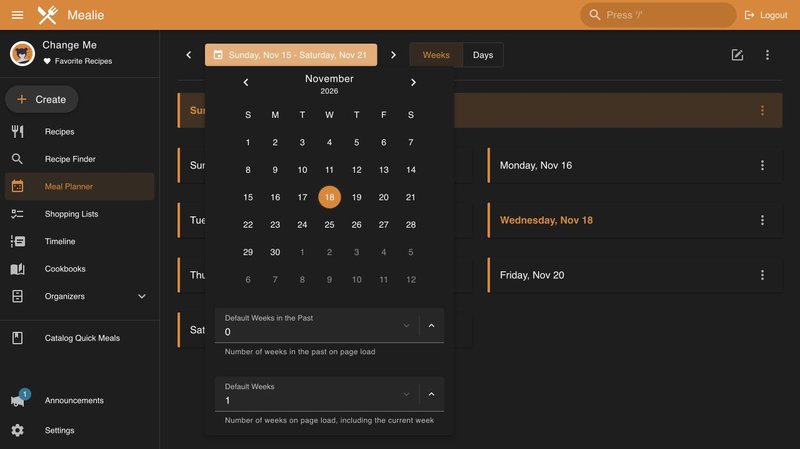
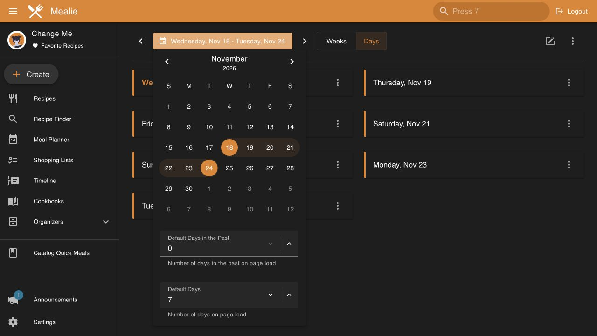
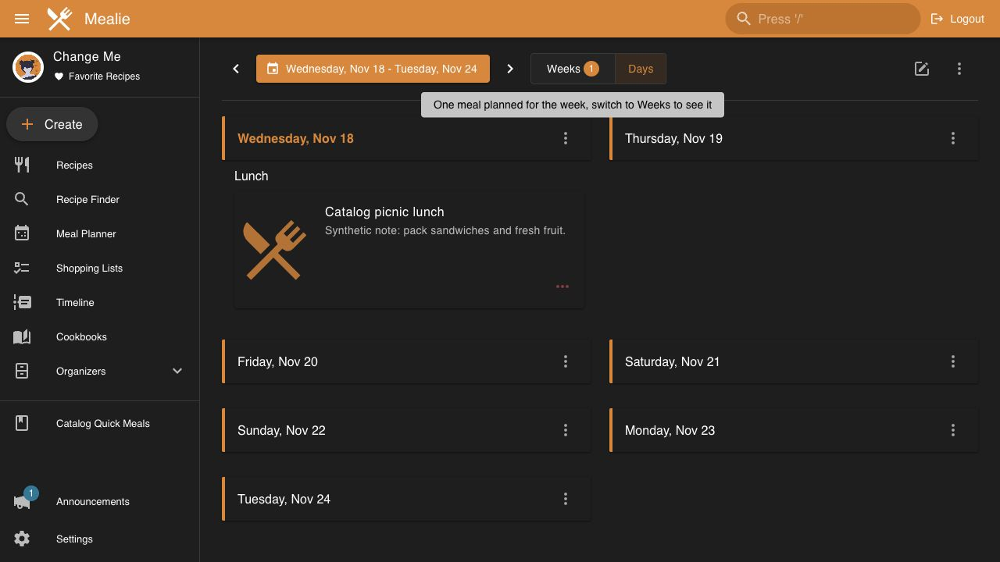

# Meal planner parent and toolbar

Route: `/household/mealplan/planner`. Source: [planner.vue](../../frontend/app/pages/household/mealplan/planner.vue).

## Functions

- Require authentication. Redirect the bare parent route to View and preserve query parameters.
- Share the toolbar, API state, and date range across View and Edit. Preserve [all shared meal-plan behavior](../shared-meal-plan.md).
- Refresh household preferences on entry so a changed first day of week takes effect within the same browser session.
- Read start/end from query parameters. Invalid ISO values fall back to the configured default range.
- Weeks mode rounds the sorted range to complete household weeks. Days mode uses the exact selected days.
- Leave a half-selected calendar range available for the second click. Normalize a completed weekly selection to full weeks.
- Previous/Next moves by the number of currently visible calendar days, not a fixed seven-day interval.
- The range popover contains the calendar and mode-specific default past-count and count controls. Minimum counts are zero past and one current/future.
- Persist day and week count preferences. Switching modes resets the range from that mode's defaults.
- Update start/end query parameters with local yyyy-MM-dd values. Preserve other query parameters and the active child route.
- Show Weeks/Days toggle. In Days mode, badge Weeks with the number of hidden week entries and explain the count in a tooltip.
- Keep View/Edit navigation and its query parameters. Menu actions include Add All to List, Subscribe to Calendar, and Settings.
- Add All uses visible recipe entries with their scales. Disable it when none exist. Days mode excludes hidden week entries from this action.
- Settings opens meal-plan rules. Calendar opens the shared feed dialog. Render the child route with current plans and actions.
- Group week entries by their stored dates. Retain a separate week row if older entries have different week boundaries.

## Screenshots

## Migration validation and optional evidence

These additional cases remain for replacement validation. See the [handoff evidence decisions](../HANDOFF.md#evidence-decisions) for shared references, preview fixtures, and unexecuted branches.

- [ ] Verify reversed/invalid dates, multiple-week ranges, DST transitions, and changed household week start during replacement.
- [ ] Verify enabled calendar-feed controls with an approved disposable credential fixture; do not expose a real feed token in artifacts.

## Shadcn Vue replacement checklist

- [ ] Use range Calendar/Popover, ToggleGroup, Badge, Tooltip, DropdownMenu, numeric Input, and Buttons.
- [ ] Preserve local date/query semantics, separate mode preferences, range navigation, week grouping, and hidden-entry count.
- [ ] Preserve recipe-scale aggregation, child-route state, calendar permissions, and manager controls.
