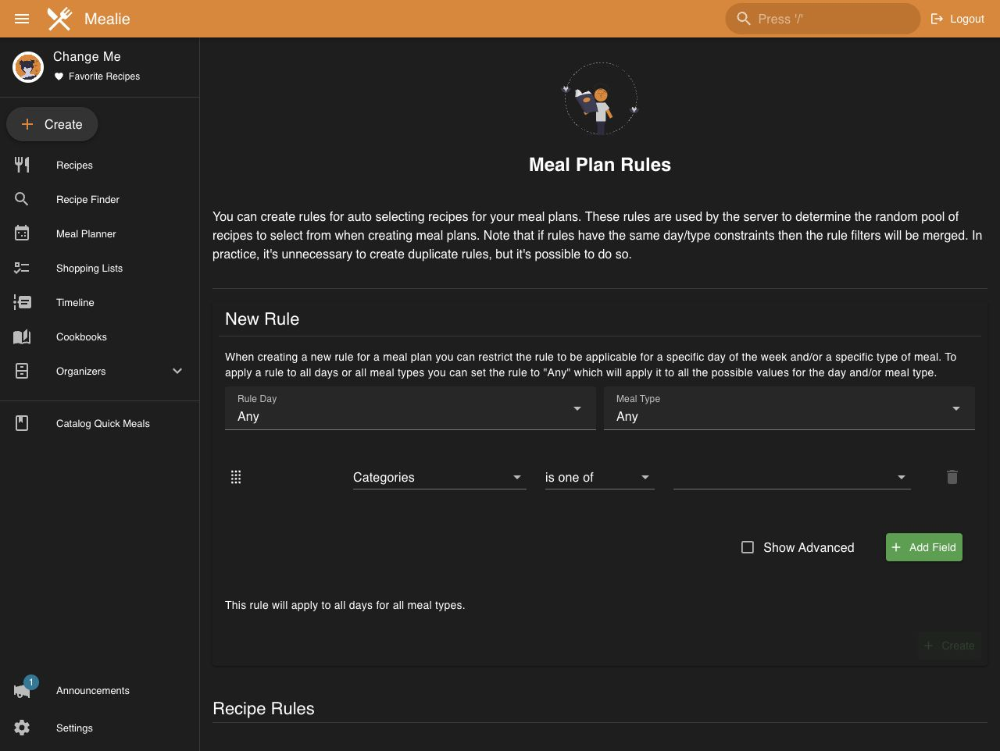
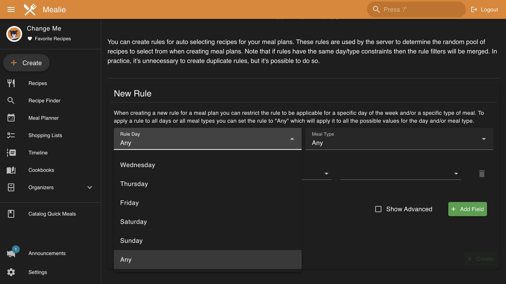
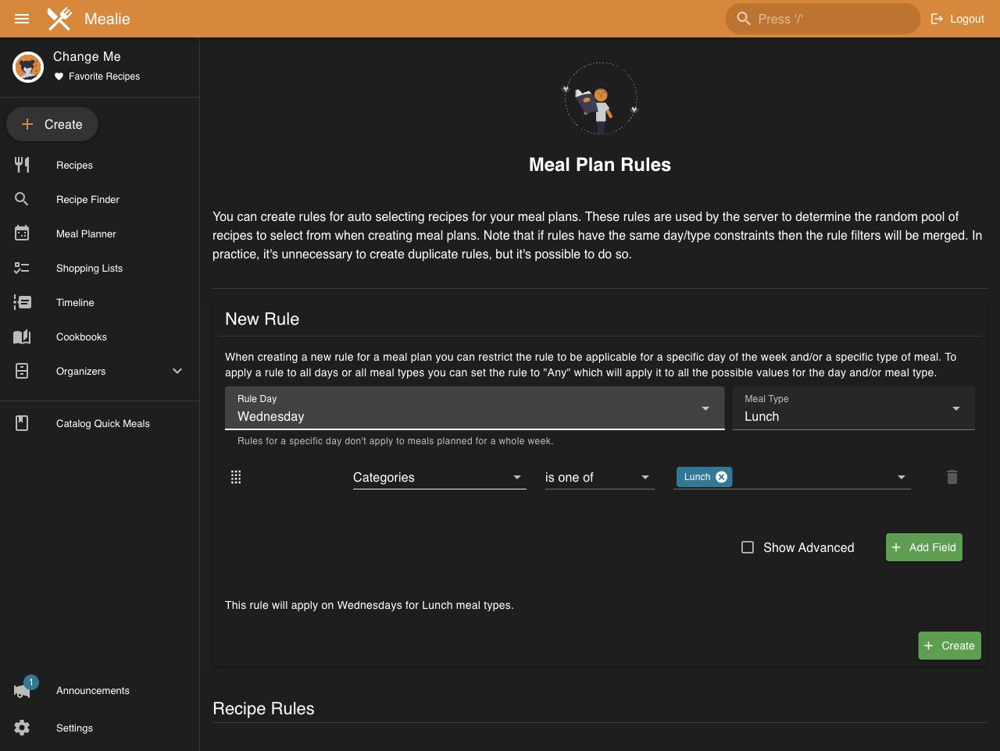
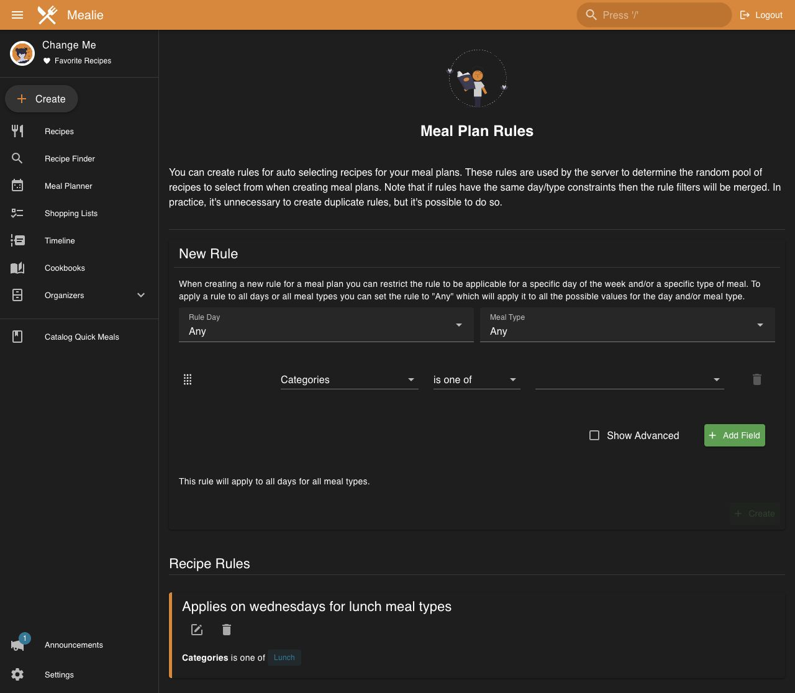
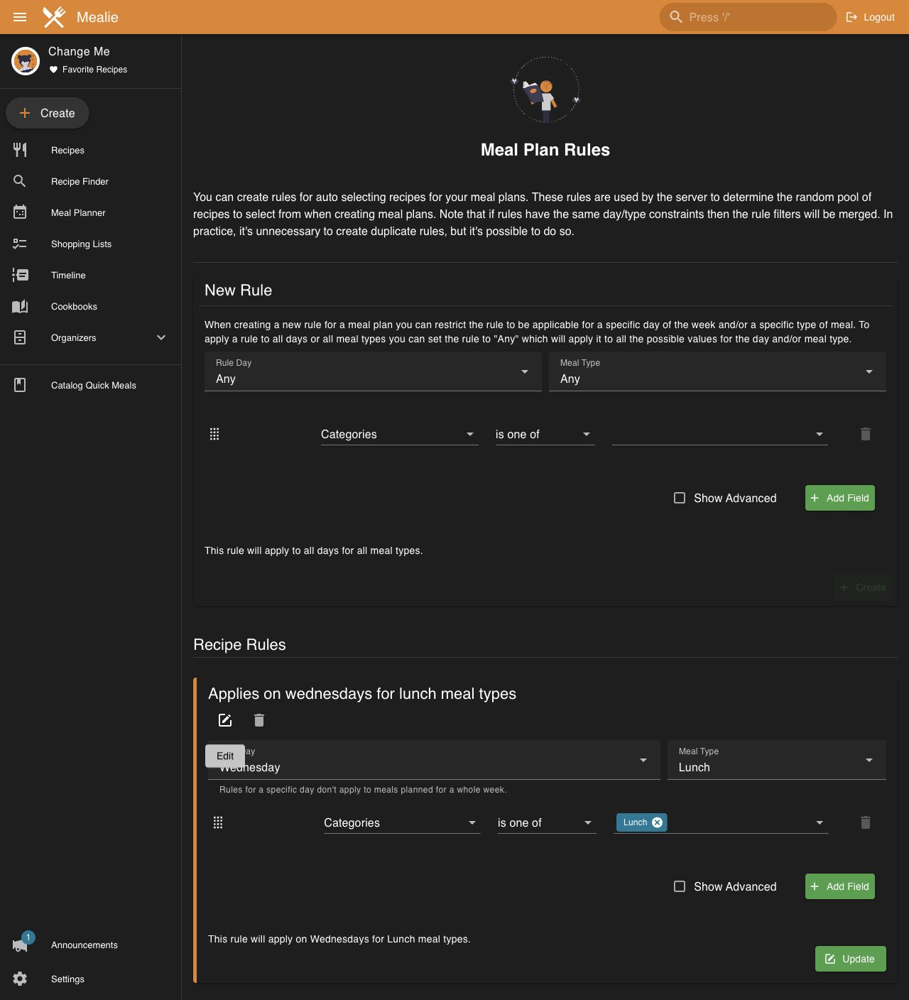
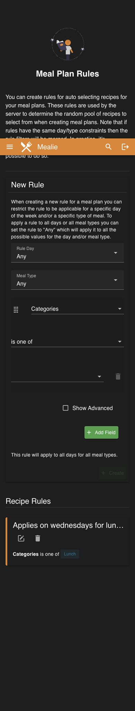

# Meal-plan rules

Route: `/household/mealplan/settings`. Sources: [page](../../frontend/app/pages/household/mealplan/settings.vue), [rule form](../../frontend/app/components/Domain/Household/GroupMealPlanRuleForm.vue), [summary](../../frontend/app/components/Domain/QueryFilterSummary.vue).

## Functions

- Require authentication. Explain how rules restrict the random recipe pool and combine when day/type scopes match.
- New Rule offers Rule Day Monday–Sunday or Any, Meal Type across all seven types or Any, and the [complete query builder](../shared-query-filter-builder.md).
- Show a live sentence for rule scope. A specific weekday shows the warning that weekday rules do not apply to whole-week entries.
- Disable Create without a generated query. Successful creation refreshes the list, resets both scopes to Any, clears the query, and remounts the form.
- Fetch existing rules on entry. Each card identifies its day/type scope and has Edit and Delete actions.
- Read-only cards display a structured query summary: field labels, localized comparison/logical operators, parentheses, organizer chips, and scalar values.
- Resolve organizer IDs through their stores. Use names/full names when available and raw IDs as fallback.
- Format dates in local time, relative dates as days ago, positive durations as localized durations, and remaining values as comma-separated text.
- Edit replaces the summary with scope selectors and the full query builder. Disable Update for an empty generated query.
- Update refreshes rules and toggles the editor closed after success. The Edit button toggles visibility; no separate Cancel or copied draft exists.
- Delete immediately calls the API and refreshes after success. The source has no deletion review dialog.
- Preserve [rule matching semantics](../shared-meal-plan.md), including AND combination, Any scopes, and whole-week exclusions.
- The rule settings page maintains its own collection. Verify that an already initialized selector rule store refreshes after changes.

## Screenshots

## Migration validation and optional evidence

These additional cases remain for replacement validation. See the [handoff evidence decisions](../HANDOFF.md#evidence-decisions) for shared references, preview fixtures, and unexecuted branches.

- [ ] Verify all typed summary values, multiple applicable rules, rule-store refresh, and API failures during replacement.
- [ ] Capture a multi-row advanced rule if its layout differs from the shared query-builder reference.

## Shadcn Vue replacement checklist

- [ ] Use Cards, Select, shared query editor/summary, Buttons, and status feedback.
- [ ] Preserve scope labels, validation, create reset, inline update, immediate delete, and whole-week exclusions.
