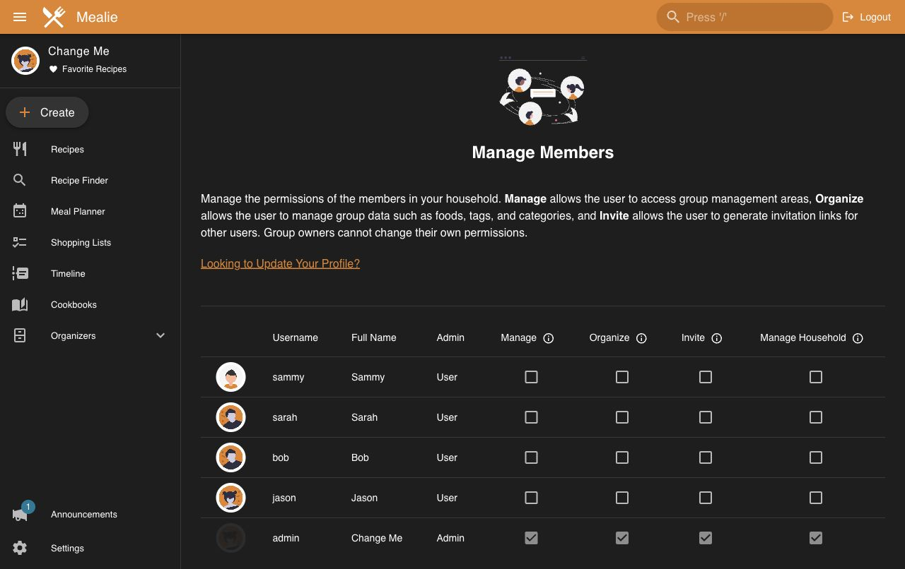
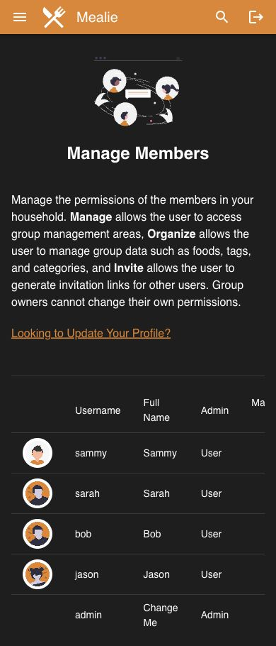

# Household member permissions

Route: `/household/members`. Source: [members.vue](../../frontend/app/pages/household/members.vue).

## Functions to preserve

- Require authentication; fetch household members on mount. The page itself declares no manager-only middleware; preserve server permission enforcement on updates.
- Explain Manage, Organize, and Invite, and link Looking to Update Your Profile to `/user/profile/edit`.
- List all members without pagination/footer: avatar, Username, Full Name, Admin/User role, Manage Group, Organize Group Data, Invite, and Manage Household.
- Keep permission-column help tooltips with their full descriptions and sortable identity columns. Permission columns and avatar are nonsortable.
- Each permission checkbox changes that row's draft and immediately invokes setMemberPermissions with user ID and all four permission booleans. There is no separate Save button or confirmation.
- Administrator rows are disabled. The intended self-row guard references `sessionUser?.id`, but no sessionUser is declared/imported in this source or found in composables/plugins; verify/fix current-user binding rather than assuming non-admin self-edit protection works.
- Keep API error feedback and rollback/reload behavior under review: the current handler awaits the request but does not explicitly refresh or revert optimistic checkbox state on failure.
- Give each checkbox an accessible label combining member name and permission; current unnamed matrix controls rely on visual row/column context.
- No permissions were changed for catalog screenshots.

## Redesign (implemented)

| Before | Now |
| --- | --- |
| A data table with an avatar column and four checkbox columns whose meaning lived in header tooltips. | A short legend explains Manage, Organize, Invite and Manage Household. Each member is a row with avatar, name, username and an Admin badge, followed by four labelled checkboxes (so it works on phones). |
| Locked checkboxes for yourself and admins gave no reason. | Locked checkboxes are dimmed with a title explaining why. |

## Screenshots

### Full member matrix, including disabled administrator row

## Migration validation and optional evidence

These additional cases remain for replacement validation. See the [handoff evidence decisions](../HANDOFF.md#evidence-decisions) for shared references, preview fixtures, and unexecuted branches.

- [ ] Verify permission help tooltips and mobile access to every column; the overflowing baseline table is captured above.
- [ ] Verify non-admin self-row behavior, unauthorized mutation rejection, and failure rollback using dedicated permission fixtures.

## Shadcn Vue replacement checklist

- [ ] Use DataTable, Avatar, Checkbox, Tooltip, and accessible row/column labels.
- [ ] Preserve all four payload permissions, immediate persistence, admin restriction, household scope, and profile link.
- [ ] Resolve self-row identity and accurate failure feedback before enabling the redesigned matrix.
