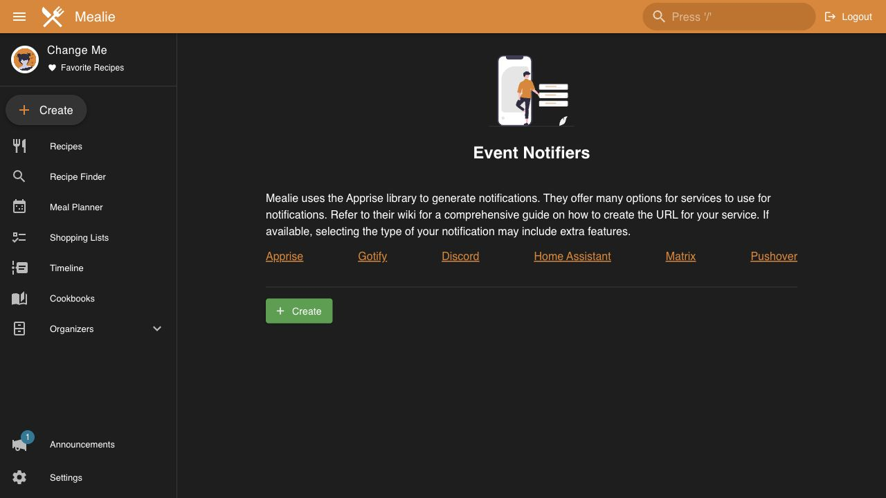
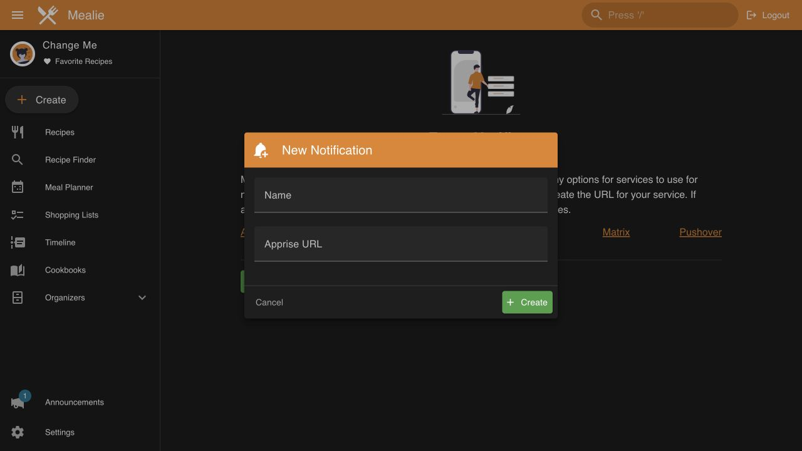
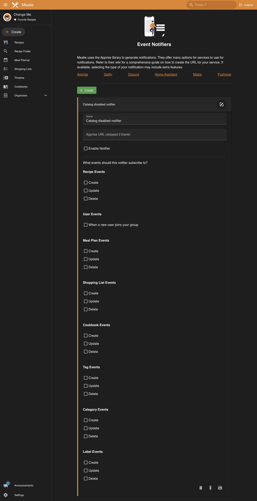
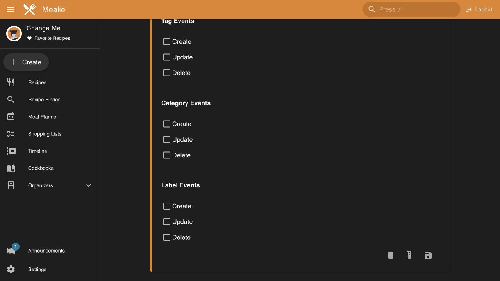
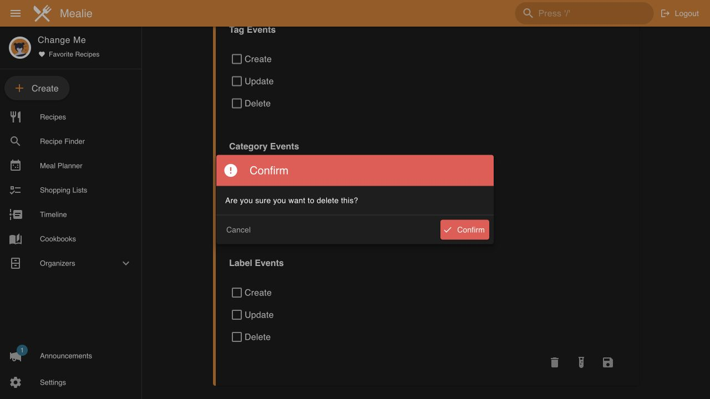
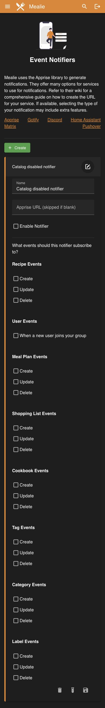
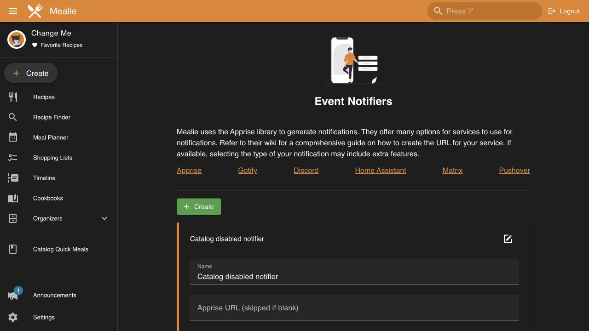
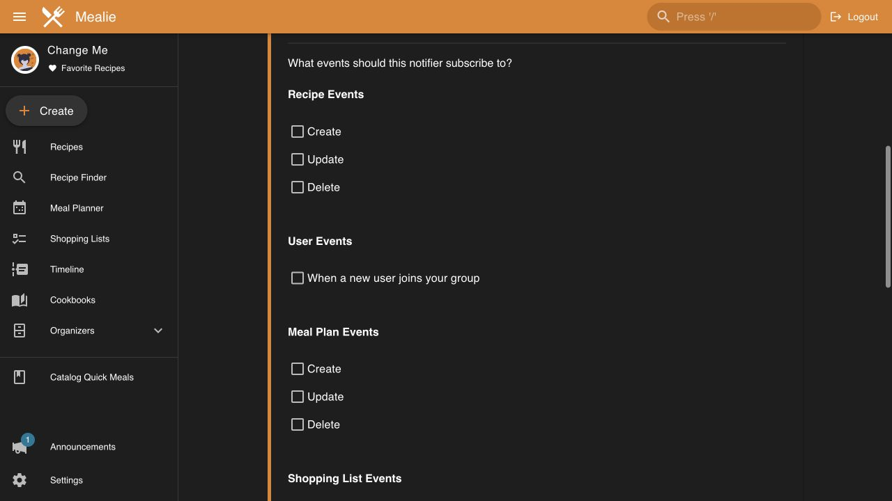

# Event notifiers

Route: `/household/notifiers`. Source: [notifiers.vue](../../frontend/app/pages/household/notifiers.vue).

## Functions to preserve

- Require authentication, Advanced Features, and Manage Household. Explain Apprise and link its wiki plus Gotify, Discord, Home Assistant, Matrix, and Pushover service guides.
- Fetch household notifiers asynchronously with deep reactivity; show each as an accordion titled by name, with edit affordance.
- Create opens New Notification with Name and Apprise URL. The initial payload enables the notifier; the template has no explicit validation rules. Submit creates and refreshes; the source does not explicitly reset the create draft after use.
- Expanded editor exposes Name, an intentionally blank Apprise URL field whose blank value preserves the saved destination, Enable Notifier, and all event subscription checkboxes.
- Keep these 22 event options and their distinct API keys: Recipe Create/Update/Delete (`recipeCreated`, `recipeUpdated`, `recipeDeleted`); New User Signup (`userSignup`); Meal Plan Create/Update/Delete (`mealplanEntryCreated`, `mealplanEntryUpdated`, `mealplanEntryDeleted`); Shopping List Create/Update/Delete; Cookbook Create/Update/Delete; Tag Create/Update/Delete; Category Create/Update/Delete; Label Create/Update/Delete. The latter groups use `{shoppingList,cookbook,tag,category,label}{Created,Updated,Deleted}`.
- Group options under eight labeled headings. Do not collapse identically named Create/Update/Delete checkboxes into indistinguishable accessibility controls; include the domain in their labels.
- Save sends the entire notifier to its update endpoint, then refreshes the list. Test invokes the stored notifier's test endpoint, not an unsaved destination draft. Preserve API feedback without claiming a dedicated success panel; this page adds none.
- Delete captures the notifier ID and opens a destructive bottom-sheet generic confirmation. Confirm deletes, refreshes, and clears target; Cancel keeps the notifier.
- The capture fixture's create schema ignored the supplied enabled flag, so it was explicitly updated to disabled before expanded screenshots. All event options remain off; no test or external notification was sent.

## Redesign (implemented)

| Before | Now |
| --- | --- |
| Illustration title with Apprise service links spread across a row; Create button below. | Heading, description and a compact row of service links, with "New Notification" beside the heading. |
| Expansion panels with an edit icon; enable as a checkbox; event checkboxes in a two-column block; button group actions. | Accordion rows with a bell (dimmed when disabled); an Enable switch, labelled fields, events grouped in two columns of labelled checkboxes; Delete on the left, Test and Save on the right; an empty state. |
| Delete confirmation as a bottom sheet. | The standard confirmation dialog. |

## Screenshots

### Help/empty state and creation

### Expanded editor with every event subscription

### Readable lower event groups/actions and deletion review

## Migration validation and optional evidence

These additional cases remain for replacement validation. See the [handoff evidence decisions](../HANDOFF.md#evidence-decisions) for shared references, preview fixtures, and unexecuted branches.

- [ ] Verify saved-URL blank preservation on update; upper/middle and mobile references are captured above.
- [ ] Validate save/test errors and subscription persistence with a local disabled fixture; do not send to real services for design evidence.

## Shadcn Vue replacement checklist

- [ ] Compose Accordion, Dialog/Sheet, Input, Checkbox, Button, Separator, and operation feedback.
- [ ] Preserve all 22 subscription keys, enabled state, retained URL semantics, stored-ID testing, and create/delete/refresh behavior.
- [ ] Name icon controls and repeated event checkboxes; preserve permission checks.
