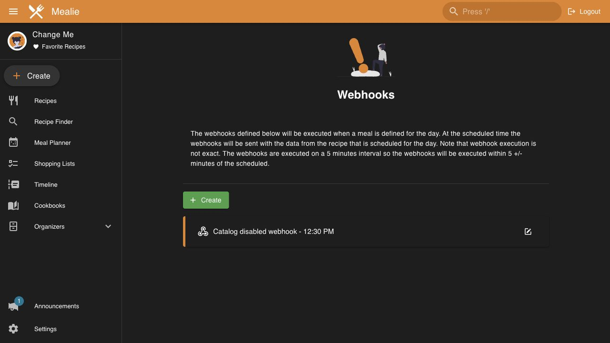
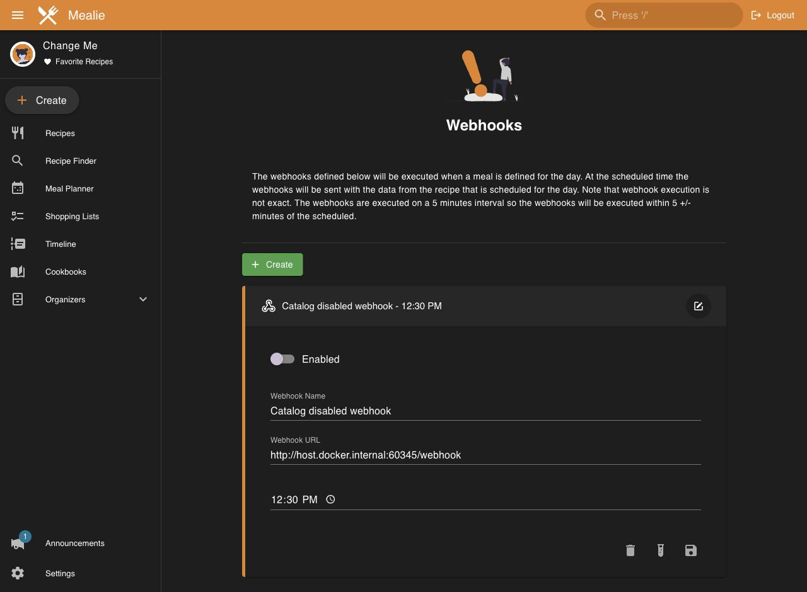
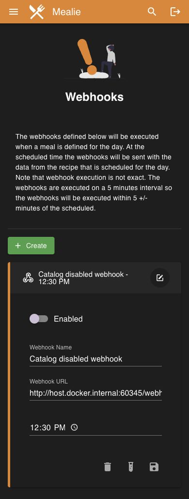

# Meal-plan webhooks

Route: `/household/webhooks`. Sources: [webhooks.vue](../../frontend/app/pages/household/webhooks.vue), [GroupWebhookEditor](../../frontend/app/components/Domain/Household/GroupWebhookEditor.vue), [use-group-webhooks](../../frontend/app/composables/use-group-webhooks.ts).

## Functions to preserve

- Require authentication, Advanced Features, and Manage Household.
- Explain that a webhook sends the day's planned recipe at its scheduled time, with execution on a five-minute interval rather than exact timing.
- Fetch all household webhooks. Each accordion header shows name, localized local scheduled time, and an enabled-state icon color. Retain accessible text for enabled status.
- Create immediately creates a stored record with Enabled true, Name New Webhook, blank URL, and UTC `00:00`, then refreshes. It does not open a separate creation form.
- Expanded editor copies the webhook into a draft. Fields: Enabled switch, Webhook Name, Webhook URL, and clearable native time input/picker. No explicit validation rules are attached here.
- Display stored UTC time in the browser's local timezone. Save passes the edited local `HH:mm` to the composable, which converts it back to UTC before updating, then refreshes on returned data.
- The editor computes a UTC draft while typing but emits its local value on Save; keep one clear conversion boundary so the replacement does not double-convert or save local time as UTC.
- Time helpers use today's date/offset, including DST effects. Verify clearing/invalid input and offset transitions; the source does not guard these cases explicitly.
- Delete emits the stored ID directly, calls delete, and refreshes on data; there is no confirmation in this component. Do not invent a nonexistent current delete dialog.
- Test invokes the stored ID. The page chains a Test Message Sent toast after the promise resolves, without independently checking returned success; preserve accurate failure feedback during redesign.
- Test does not save unsaved URL/time changes. Save is distinct from test/delete. The local editor copy is initialized once; verify refreshed props remain reflected after save.
- The disabled fixture uses a local-only URL and UTC 19:30, shown as 12:30 PM in the America/Phoenix capture environment. No webhook was tested or scheduled to run during captures.

## Redesign (implemented)

| Before | Now |
| --- | --- |
| Illustration title, a Create button, and expansion panels titled "name - time". | Heading with a "New webhook" button; webhooks in an accordion showing name, time and "Disabled" when off; an empty state. |
| Editor: Vuetify switch, underlined fields and an unlabelled time field; a button group for Delete/Test/Save. | Enabled switch, labelled Name, URL and "Runs at" fields; Delete on the left, Test and Save on the right. |

## Screenshots

### Collapsed scheduled webhook and full editor

## Migration validation and optional evidence

These additional cases remain for replacement validation. See the [handoff evidence decisions](../HANDOFF.md#evidence-decisions) for shared references, preview fixtures, and unexecuted branches.

- [ ] Verify mobile controls and create-draft isolation against the expanded mobile reference; optionally capture a new-record state if it adds information.
- [ ] Verify time clearing, native picker, UTC round-trip/DST, refreshed draft synchronization, and local-only test feedback. The native popup was exposed in accessibility state but absent from the browser screenshot, so no duplicate image is labeled as a visible picker.

## Shadcn Vue replacement checklist

- [ ] Compose Accordion, Switch, Input, native time input or equivalent accessible picker, Button, and feedback.
- [ ] Preserve scheduled UTC/local conversion, enabled status, immediate create, stored-ID test, separate save, and refresh behavior.
- [ ] Add accessible names to icon actions and retain household-manager/advanced guards.
