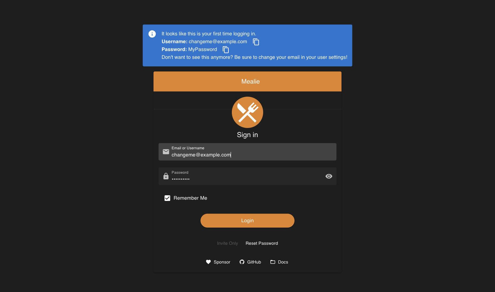

# Root entry and redirects

Route: `/`. Source: [index.vue](../../frontend/app/pages/index.vue).
Layout: [blank.vue](../../frontend/app/layouts/blank.vue).
Status: source contract and visual references reviewed; runtime validation remains in the checklists below.

This route renders an empty `div` while it resolves the destination.
It is a navigation controller, not a separate home dashboard.

## Functions to preserve

- Read the authenticated user and group slug from the auth composable.
- For an anonymous visitor, request `/api/app/about`.
- If the API supplies `defaultGroupSlug`, go to that group's recipe view.
- Otherwise go to `/login`.
- For an authenticated user with a group, request `/api/app/about/startup-info`.
- A first-login administrator on a non-demo instance goes to `/admin/setup`.
- Other users go to their preferred activity: recipes, meal planner, or shopping lists.
- Retain the default-activity helper's fallback behavior, including its `/g/home` default.
- Retain the group's recipe view as the final route fallback.
- Keep the blank layout's demo notice and toast support during the transition.

Source: [use-default-activity.ts](../../frontend/app/composables/use-default-activity.ts).
Public group visibility and activity preferences determine which destination the user sees.

## Screenshot evidence

There is no independent page body to redesign. The anonymous private-site destination is Login.

See [Login](login.md) for the destination's full controls and state captures.
Add links to the setup and preferred-activity captures as those page catalogs complete.

## Shadcn Vue replacement checklist

- [ ] Preserve the destination rules while the surrounding layouts change.
- [ ] Do not replace this route with a new dashboard that removes preferred-activity navigation.
- [ ] Verify anonymous private/public sites, first admin login, demo mode, and each saved activity preference.
- [ ] Decide whether to add an accessible transient loading status as an explicit design improvement.
