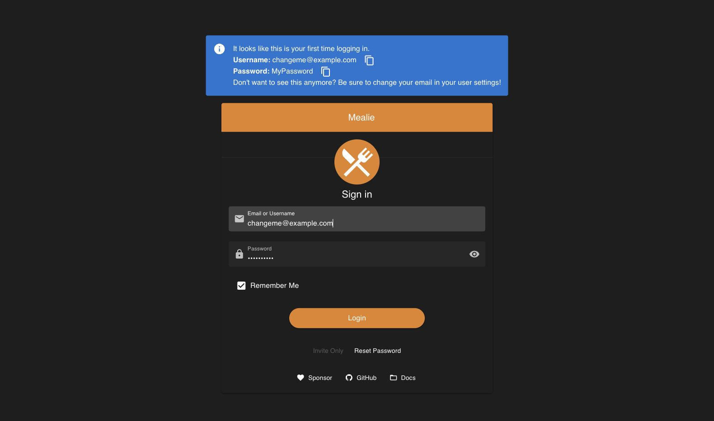
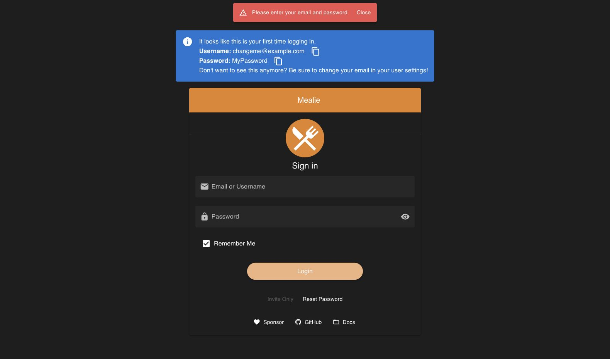
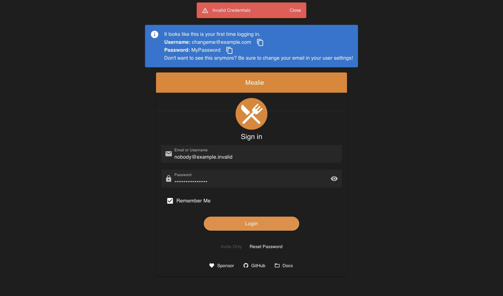
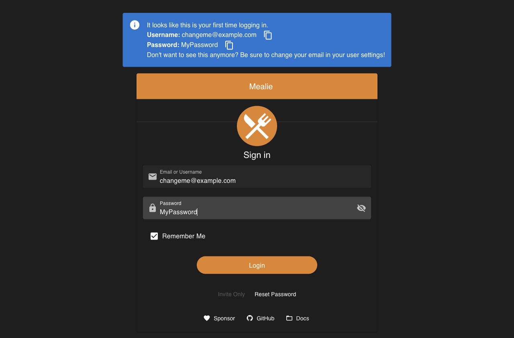
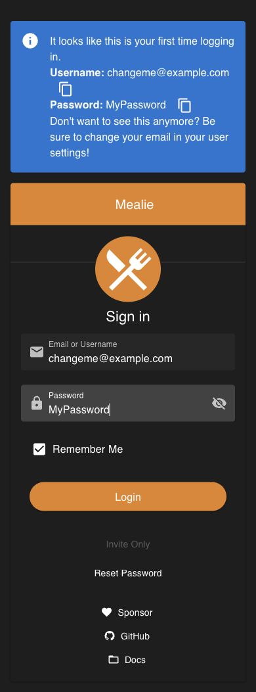

# Login

Route: `/login`. Source: [login.vue](../../frontend/app/pages/login.vue).
Layout: [blank.vue](../../frontend/app/layouts/blank.vue).
Status: source contract and visual references reviewed; runtime validation remains in the checklists below.

## Functions to preserve

- Enter an email address or username and an existing password.
- Autofocus the username field. Preserve username and current-password autocomplete attributes.
- Show or hide the password with the field's appended icon.
- Submit with the Login button or the form's Enter action.
- Remember Me defaults to enabled. Send its value as `remember_me`, not only as a browser preference.
- Reject empty username or password locally with a toast. Do not send an empty login request.
- Show login progress. Prevent password submission while OIDC login is in progress.
- Show distinct messages for invalid credentials (`401`), account lock (`423`), and other failures.
- Hide the password fields, Remember Me, password Login, and password-reset link when password login is disabled.
- Show Register only when both signup and password login are enabled. Otherwise show the disabled Invite Only control.
- Link to password recovery, Sponsor, GitHub, and Docs. Open external links in a separate tab.
- Show the first-login help banner only when startup information identifies the default account.
- Prefill the default username and password for that first-login state.
- Copy either default credential with its own copy button.
- Match light and dark themes. Retain the blank layout's demo banner and global toasts.

## Authentication branches

| Condition | Required behavior |
| --- | --- |
| OIDC enabled | Show the provider login action and configured provider name. |
| OIDC and password login enabled | Show both methods with their divider. |
| Automatic OIDC redirect enabled | Start OIDC automatically unless this is a callback or `?direct=1`. |
| `code` or `error` callback query | Finish OAuth login. On failure replace the URL with `/login?direct=1` and show an error. |
| Reverse-proxy auth enabled | Try header-based sign-in before the normal form; show a spinner during that attempt. |
| Missing or invalid proxy header | Stop the spinner and expose the normal login form. |
| `?direct=1` | Bypass automatic OIDC and reverse-proxy sign-in. |

## Destination rules

1. A non-demo administrator's first login goes to `/admin/setup`.
2. Otherwise honor a safe local `redirect` query or a saved PWA-share redirect.
3. Preserve the PWA redirect in session storage across the external OIDC round trip.
4. Clear the pending redirect after use. Reject unsafe external redirect targets.
5. Otherwise use the user's preferred recipe, meal-planner, or shopping-list activity.
6. Fall back to the user's group recipe view when the preferred destination is unavailable.

Sources: [redirect validator](../../frontend/app/lib/validators/redirect.ts), [default activity](../../frontend/app/composables/use-default-activity.ts),
[password field](../../frontend/app/composables/use-passwords.ts), [auth composable](../../frontend/app/composables/use-mealie-auth.ts).

## State screenshots

### First login, default values, copy controls, and complete page

### Empty credentials and local validation toast

### Rejected credentials

## Migration validation and optional evidence

These additional cases remain for replacement validation. See the [handoff evidence decisions](../HANDOFF.md#evidence-decisions) for shared references, preview fixtures, and unexecuted branches.

- [ ] Capture the ordinary login page after the default account no longer exists.
- [ ] Verify password visibility and narrow-screen controls against the references above.
- [ ] Capture signup enabled and password login disabled.
- [ ] Capture OIDC-only, combined-method, callback failure, and reverse-proxy progress states with local provider fixtures.
- [ ] Capture the account-locked error with a disposable local account.

## Shadcn Vue replacement checklist

- [ ] Replace the card, toolbar, fields, checkbox, buttons, icons, alert, divider, and progress spinner.
- [ ] Use labeled Inputs, Button, Checkbox, Card, Alert, Separator, and a status indicator with equivalent semantics.
- [ ] Retain visible labels, keyboard submission, password-manager compatibility, and accessible password-toggle names.
- [ ] Retain every authentication and destination branch above.
- [ ] Keep toast announcements accessible and preserve focus during failed login.
- [ ] Verify the default-account, ordinary-account, safe redirect, Remember Me, and PWA-share workflows.
