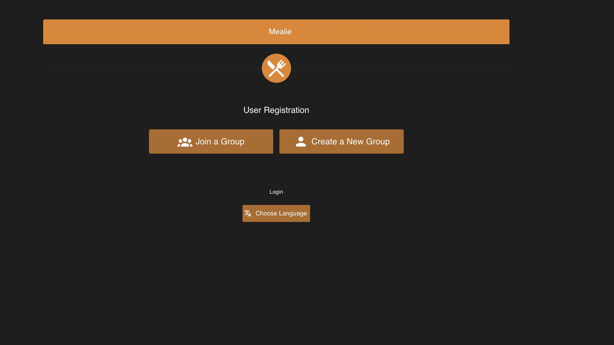
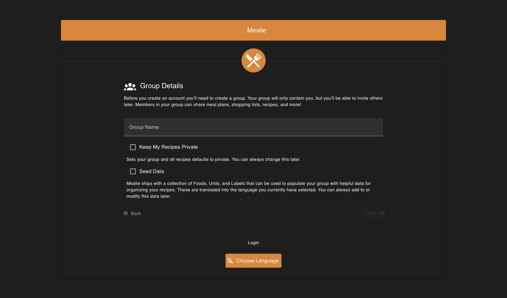
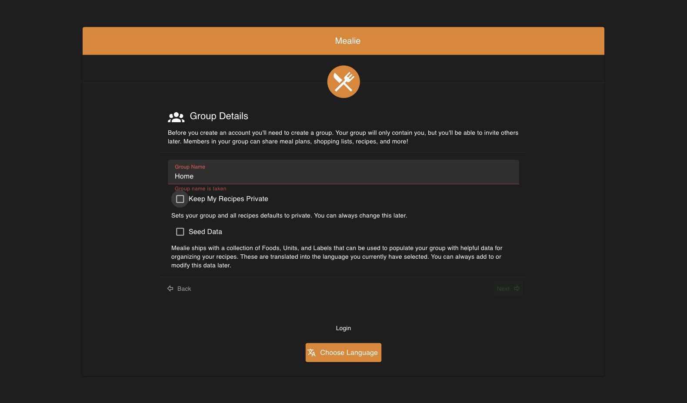
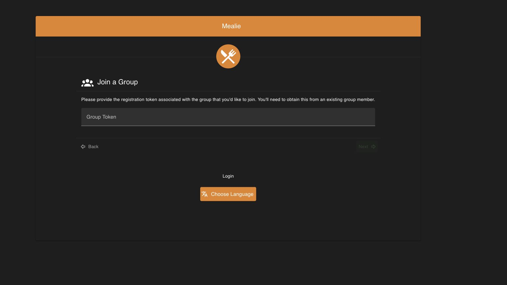
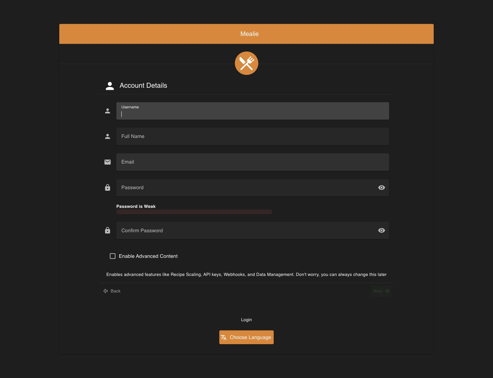
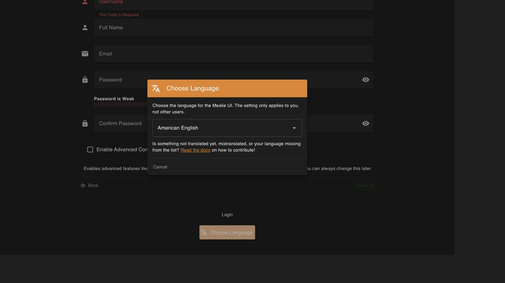
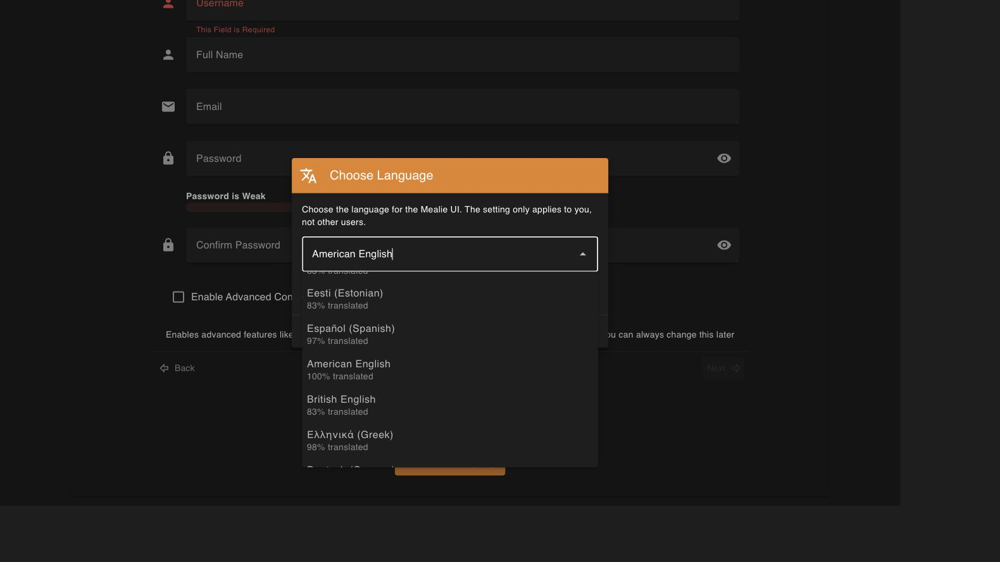
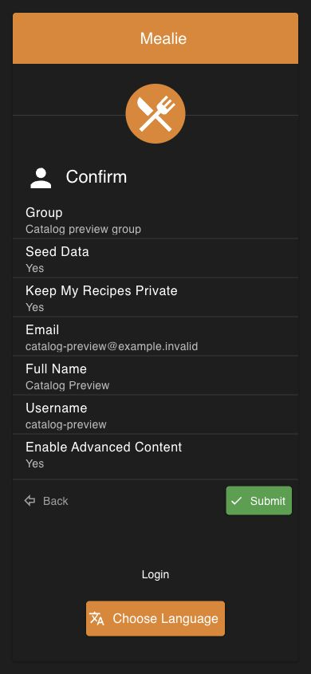
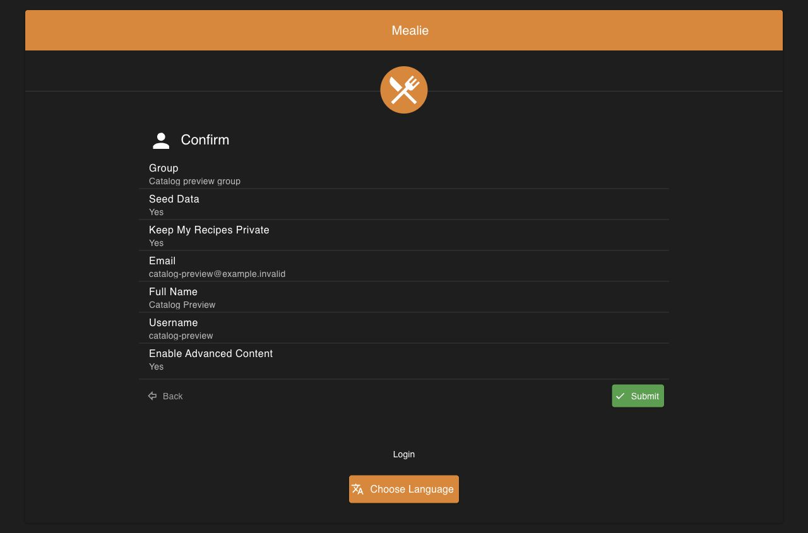
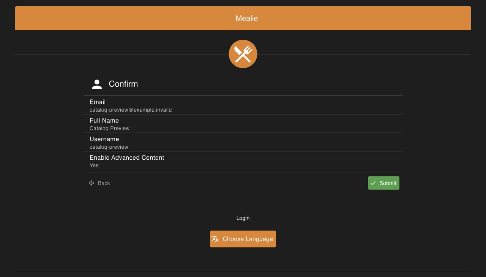

# Registration

Route: `/register`, optionally `?token=...`.
Source: [register/index.vue](../../frontend/app/pages/register/index.vue).
Layout: [blank.vue](../../frontend/app/layouts/blank.vue).
Status: source contract and visual references reviewed; runtime validation remains in the checklists below.

## Redesign (implemented)

| Before | Now |
| --- | --- |
| 1200px card with a primary "Mealie" toolbar and logo; two solid primary tiles for Join / Create. | Sign-in frame, wider. The first step asks how you're joining, with two option cards that explain each path. |
| Each step had its own icon title, dividers and Back/Next buttons. | Every step shows "Step N of 3", a title and description, the fields, and one Back / Next row. Enter submits the step. |
| Confirmation was a Vuetify list with dividers. | "Review and create" shows a two-column summary; the final button reads "Create account". |
| Password strength as a thick coloured progress bar indented under the field. | A slim meter under the password with the strength label. |
| Login and Choose Language buttons inside the card's footer. | "Already have an account? Sign in" and a Choose Language button under the card. The language dialog uses a searchable select. |

## Flow and navigation

- Start with Join a Group and Create a New Group choices.
- Join a Group opens the invitation-token step.
- Create a New Group opens the group-details step and clears any previous token query.
- A nonempty `token` query starts directly at Account Details in Join Group mode.
- Back restores the previous wizard state from the history stack.
- Keep the Login link and Choose Language action available throughout the wizard.
- Do not infer availability from the Login page's Register button alone; the registration API enforces signup policy.
- The state enum contains unused states. Do not invent UI for `ProvideCredentials` or `SelectGroupOptions`.
- `initialUser()` currently returns false. The source contains an inactive Initial Group branch.

## Group-details step

- Require a nonblank group name.
- Check group-name availability through the public validator on blur and before Next.
- Show the duplicate-name error on the field. Disable Next until the form and availability checks pass.
- Offer Keep My Recipes Private, default false, with its explanation.
- Offer Seed Data, default false, with its explanation and current-locale dependency.
- Retain values when the user moves backward and forward.

## Invitation-token step

- Require a nonblank token. Keep it in the `token` query parameter.
- Explain that an existing group member provides the token.
- Disable Next when the token is blank or whitespace.
- Validate the form before advancing.
- A nonempty token only passes the client gate. The server checks validity during registration.

## Account-details step

Shared component: [UserRegistrationForm.vue](../../frontend/app/components/Domain/User/UserRegistrationForm.vue).
Shared state and validators: [user-registration-form.ts](../../frontend/app/composables/use-users/user-registration-form.ts).

- Require Username, Full Name, Email, Password, and Confirm Password.
- Check username and email availability with public API validators and show their field errors.
- Validate email format.
- Require password length between 8 and 258 characters and matching confirmation.
- Show the password-strength label and progress indicator.
- Show or hide both password fields through the shared password-visibility state.
- Offer Enable Advanced Content, default false, with its feature explanation.
- Gate Next on form validity and recheck async availability before advancing.

## Confirmation and submission

- Show group name, seed-data choice, and privacy choice for Create Group mode.
- Show email, full name, username, and advanced-content choice in both modes.
- Provide Back to revise the details and Submit to register.
- Send account fields, password and confirmation, locale, and advanced-content choice.
- For Create Group, also send `group`, `private`, and `seedData`.
- For Join Group, send `groupToken` instead.
- On HTTP `201`, clear account and password form state, show success, and navigate to `/login`.
- Preserve API detail messages from the Axios interceptor. Show a generic failure only when no detail message exists.

## Language dialog

- Open the shared locale dialog from any step.
- Search available UI locales with normalized filtering.
- Show each language's translation-completion percentage.
- Apply the selected locale for this user and close the dialog when it changes.
- Provide Cancel and a link to translation-contribution documentation.

Source: [LanguageDialog.vue](../../frontend/app/components/global/LanguageDialog.vue).

## State screenshots

### Initial choices

### New-group details and options

### Duplicate group name

### Invitation-token entry

### Complete account form, password strength, and advanced-content control

### Language dialog

### Expanded locale options

The confirmation screenshots use a temporary initializer in the isolated checkout, restored with [the preview helper](../scripts/registration-preview-fixture.mjs). They show the actual template with noncredential synthetic fields. No password was entered and Submit was not invoked. These are layout previews, not proof of successful registration.

## Migration validation and optional evidence

These additional cases remain for replacement validation. See the [handoff evidence decisions](../HANDOFF.md#evidence-decisions) for shared references, preview fixtures, and unexecuted branches.

- [ ] Verify account field validation and both confirmation payloads with disposable fixtures; both confirmation layouts are previewed above.
- [ ] Capture server rejection for an invalid invitation token.
- [ ] Capture a successful registration result with a disposable fixture.
- [ ] Capture narrow-screen layout, especially the fixed preferred-width sections.

## Shadcn Vue replacement checklist

- [ ] Replace Cards, Toolbar, fields, checkboxes, lists, dividers, buttons, form validation, progress, and the locale dialog.
- [ ] Keep the wizard's data and history separate from its visual step presentation.
- [ ] Preserve both registration modes, deep-link tokens, async validation, and locale selection.
- [ ] Preserve password-strength feedback and accessible password-toggle names.
- [ ] Make choice cards keyboard-operable buttons or links.
- [ ] Verify Back and Next retain state and Submit sends the correct mode-specific payload.
