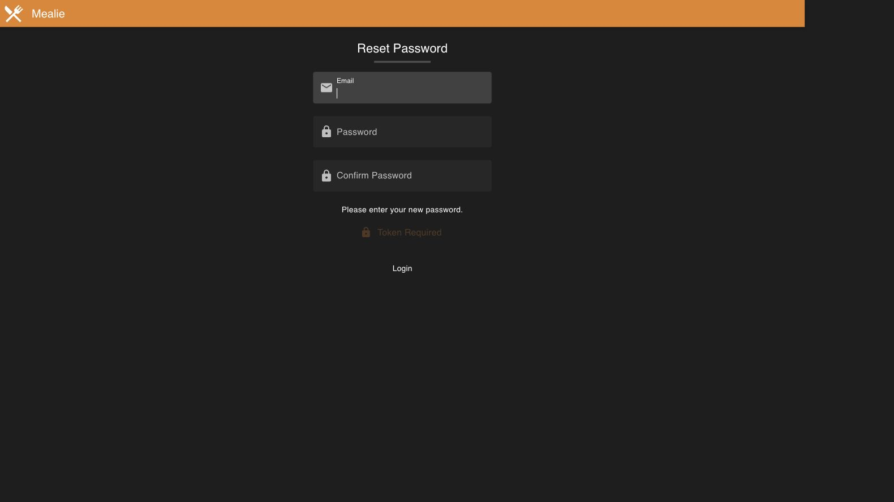
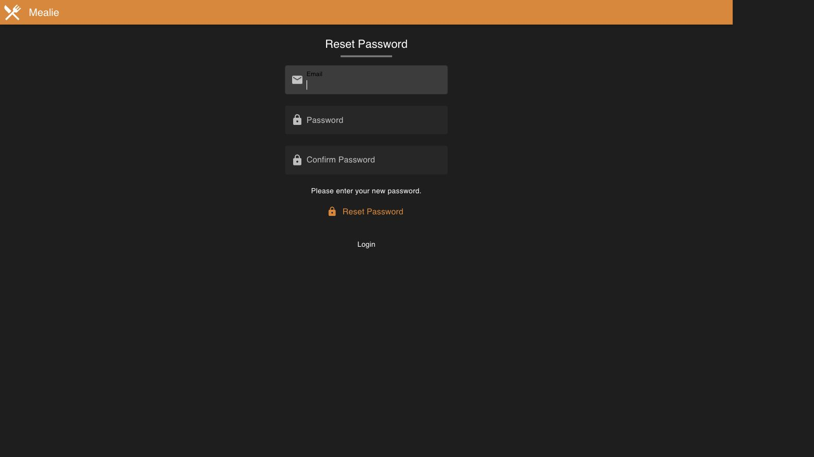
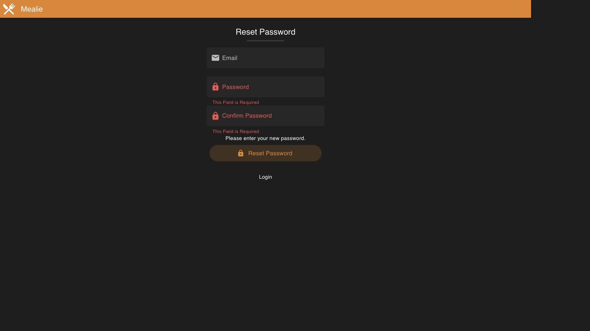
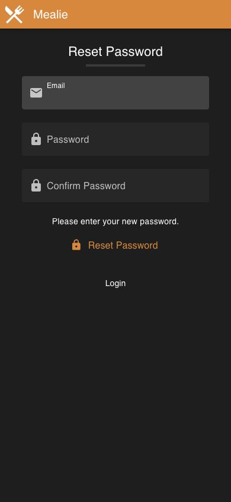

# Reset password

Route: `/reset-password?token=...`. Source: [reset-password.vue](../../frontend/app/pages/reset-password.vue).
Layout: [basic.vue](../../frontend/app/layouts/basic.vue).
Status: source contract and visual references reviewed; runtime validation remains in the checklists below.

## Functions to preserve

- Read the reset token from the `token` query parameter. Track later query changes through `useRouteQuery`.
- Show Email, Password, and Confirm Password fields, plus the instruction text.
- Autofocus Email. Mask both password fields.
- Require Password and Confirm Password. Check that the two passwords match.
- Keep the current email behavior: the template does not attach an email-format rule on this page.
- Disable submission when the token is empty and label that state Token Required.
- With a token present, enable the Reset Password action and allow form submission with Enter.
- Validate the form before calling `api.users.resetPassword`.
- Send `token`, `email`, `password`, and `passwordConfirm` together.
- Show progress during the request and clear progress after the response.
- On HTTP `200`, show Password Updated and navigate to `/login`.
- On HTTP `400`, show the invalid-reset-link message and add a Forgot Password link.
- On other failures, show the generic error toast and keep the form.
- Always provide a Login link and retain the basic header's home link.

Sources: [route query helper](../../frontend/app/composables/use-router.ts),
[validators](../../frontend/app/composables/use-validators.ts).

## Redesign (implemented)

| Before | Now |
| --- | --- |
| Without a token the button read "Token Required" (untranslated). | A red note explains the link is missing its token, the button is disabled, and "Request a new link" is offered. |
| Flat card with filled fields. | Sign-in frame with labelled fields (each password field has show/hide). |
| Forgot Password / Login text buttons. | "Request a new link" (when the link is invalid or missing) and "Back to sign in". |

## State screenshots

### Missing token

### Token query present

This screenshot uses a deliberately invalid example token. Its presence enables the form; the server validates the token on submission.

### Required password fields

## Migration validation and optional evidence

These additional cases remain for replacement validation. See the [handoff evidence decisions](../HANDOFF.md#evidence-decisions) for shared references, preview fixtures, and unexecuted branches.

- [ ] Capture password mismatch, invalid/expired token response, and the resulting recovery link with a disposable fixture.
- [ ] Capture the successful-reset destination with a disposable fixture.
- [ ] Verify narrow-screen usability against the reference above.

Do not show usable reset tokens or actual account passwords in screenshots.

## Shadcn Vue replacement checklist

- [ ] Replace the card layout, Form, TextFields, Buttons, Icon, and BaseDivider.
- [ ] Preserve token gating, validation timing, masked input, field labels, loading state, and result messages.
- [ ] Preserve the error-only recovery link and the always-available Login link.
- [ ] Verify all three response branches and query-token changes.
