# Shopping-list detail

Route: `/shopping-lists/:id`. Source: [page](../../frontend/app/pages/shopping-lists/[id].vue). Read [state and synchronization](../shared-shopping-list-state.md) as part of this page's function contract.

## Functions: header, sections, and bulk actions

- Require authentication. Load by route ID. All Lists returns to the overview with disableRedirect=true.
- Show the name in the desktop toolbar or a separate mobile title. Keep header actions available at narrow widths.
- Preserve search threshold, visibility, matched checked counts, disabled bulk/drag actions, and empty search state from the shared contract.
- Copy menu offers Text and Markdown. Check All opens a review only when an unchecked item exists.
- Menu offers Reorder Labels and Manage Labels. Manage Labels navigates to group data labels.
- Show collapsible colored label groups, unlabeled section, checkbox rows, and a checked section with count, Uncheck All, and Delete Checked.
- Uncheck/Delete Checked each require review and do nothing with no checked items. Cancel retains current state.
- Checkboxes toggle immediately. Checking an unchecked row shows a delayed toast with Undo for four seconds; Undo queues an uncheck.
- Checked rows show strike-through text and localized completion date. Preserve checked sort order and expanded search results.
- Show an offline banner and failed-write feedback. Preserve every queue, merge, polling, and retry rule in the shared contract.
- Keep Screen Awake appears only when supported. Persist preference, request/release screen wake lock, and release it on unmount.

## Functions: add and edit items

Sources: [quick add](../../frontend/app/components/Domain/ShoppingList/ShoppingListQuickAdd.vue), [item](../../frontend/app/components/Domain/ShoppingList/ShoppingListItem.vue), [editor](../../frontend/app/components/Domain/ShoppingList/ShoppingListItemEditor.vue), [details](../../frontend/app/components/Domain/ShoppingList/ShoppingListItemDetails.vue).

- Desktop shows inline quick add. Mobile uses a bottom drawer that expands for More Options and collapses on outside click.
- Ignore teleported autocomplete overlays when detecting outside clicks. Place mobile suggestions above the drawer.
- Add Item searches food choices. Selecting a food saves immediately only when details stay closed.
- Enter submits free text. Resolve food only for an exact name, plural name, or alias match. Keep other text as a note.
- Combine unmatched typed text with the note field using a comma. Do not silently select a fuzzy food match.
- More Options contains nonnegative fractional quantity, creatable unit selector, clearable multiline note, label selector, and Save.
- Offer Save As New Food for nonempty text with no exact food match. Create the food, assign its ID, and submit after success.
- When a selected food has a default label, copy it if no label exists. Save Label updates the food when the selected label differs.
- Enter in quantity or note saves; Shift+Enter in note keeps a newline. Preserve clear controls and focus return after submission.
- Item Edit opens a local copy with creatable Food, quantity, creatable Unit, Note, Label, Save Label, Delete, Cancel, and Save.
- Reset zero/null quantity to zero. A food change resets its label. Cancel closes without saving the copy.
- Row menu, opened from the drag handle, offers Edit and Delete. The direct Edit icon provides another path.
- Drag unchecked rows within label groups with 250ms touch delay. Pause polling while dragging. Search disables drag.
- Swipe in the reading direction toggles checked at 50px. Detect horizontal versus vertical movement after 8px; keep vertical/ambiguous gestures as scroll.
- Clamp swipe displacement to 100px and dim after threshold. Reverse direction for RTL. Preserve a checkbox alternative.
- Item recipe button toggles attributed recipe links. Below the list, show linked recipe descriptions, quantity, plus/minus, and offline-disabled navigation.

## Redesign (implemented)

Changes users will notice:

| Before | Now |
| --- | --- |
| Vuetify toolbar with the list name, an "All Lists" button and a three-dot menu; a separate mobile title. | One header everywhere: back arrow to all lists, the name, a "N left to get" count, a search toggle and a "…" menu (Check all, Copy as text, Copy as Markdown, Reorder labels, Manage labels). |
| Label groups were expansion panels with tag icons. | Each label is a heading with its colour dot and a collapse chevron above a single card of rows. |
| Square checkboxes; a separate "recipe" icon button on each row. | Round check buttons; "For {recipe}" under the item opens the recipe links. Edit (pencil) and the grip handle stay; the grip opens Edit/Delete and still drags. |
| Checked items in an expansion panel; Uncheck All and Delete Checked were icon buttons in its header. | "N items checked" heading that opens the list, with Uncheck all and Delete checked as labelled buttons beside it. |
| Desktop quick add was a Vuetify combobox; More Options was a separate tooltip button below. | One add field with food suggestions, a sliders button for more options and an Add button. Nothing is picked until the arrow keys highlight a suggestion, so Enter never chooses a fuzzy match. |
| Phone add form was a bottom drawer whose Save button fell off the screen. | The add field docks above the bottom tab bar and grows upward for more options, scrolling inside itself so Save is always reachable. |
| Linked recipes in elevated Vuetify sheets with +/- icons. | Linked recipes as bordered rows with a thumbnail, description and a − count + stepper. |
| Label colours drawn as Vuetify chips. | Label chips are pills that pick dark or light text for the label colour. |

## Screenshots

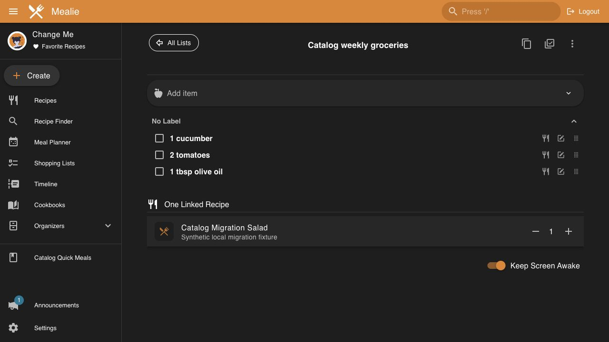
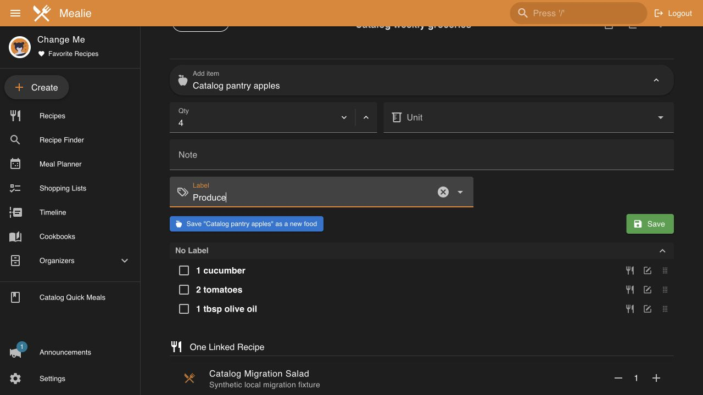
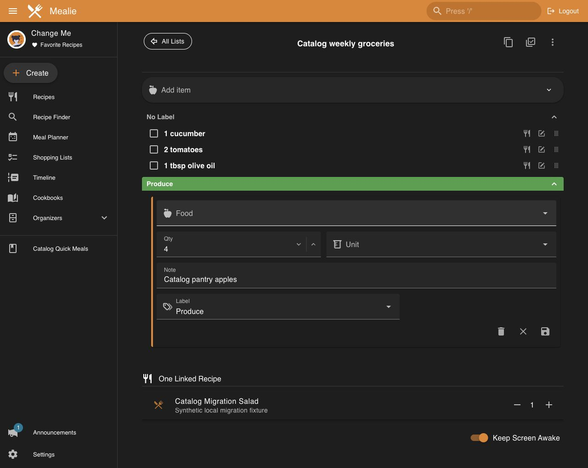
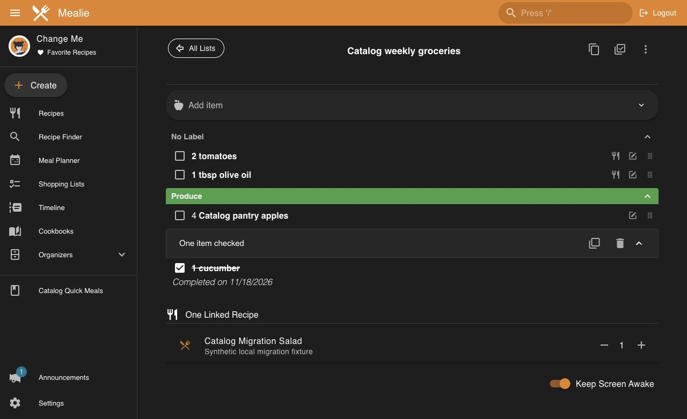
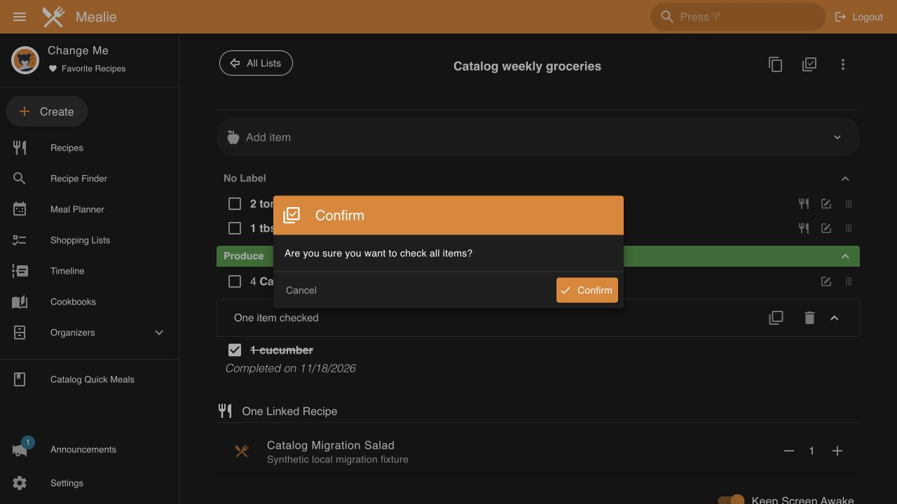
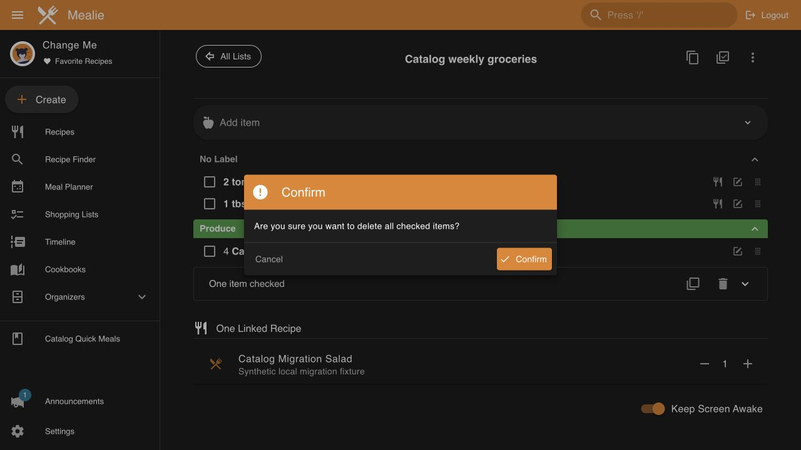
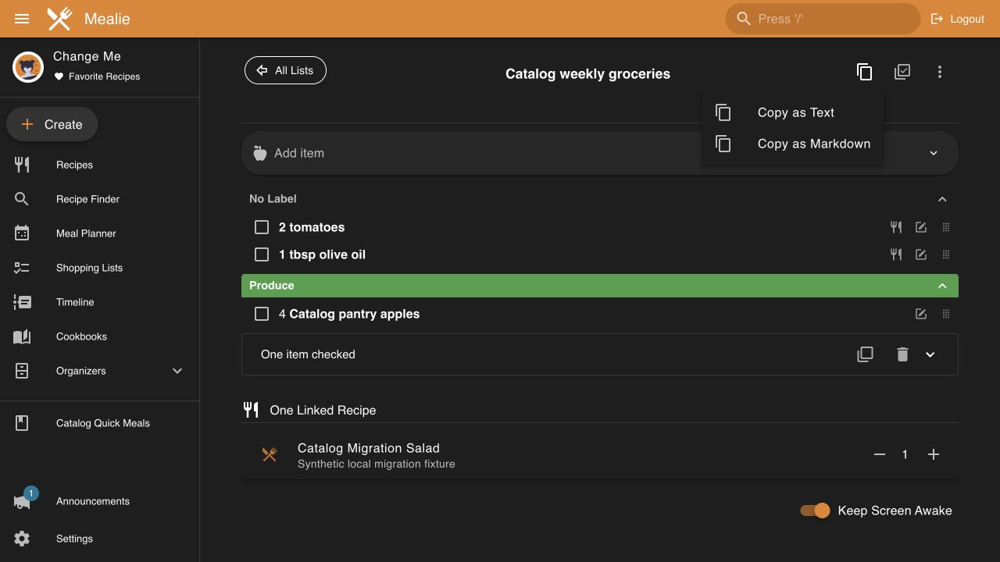
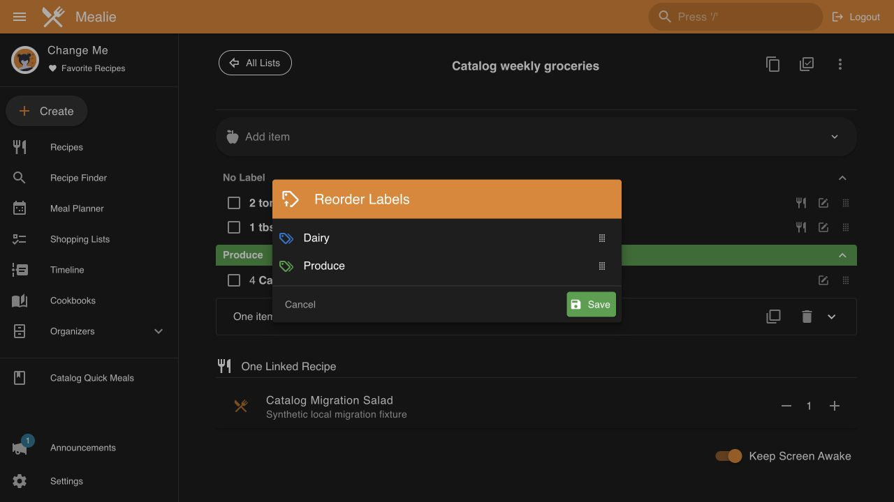
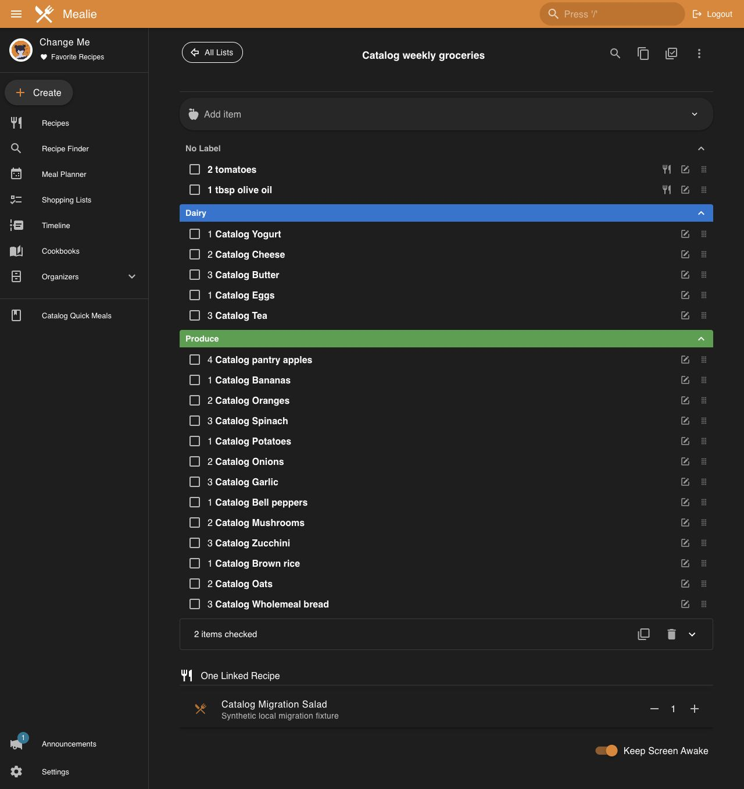
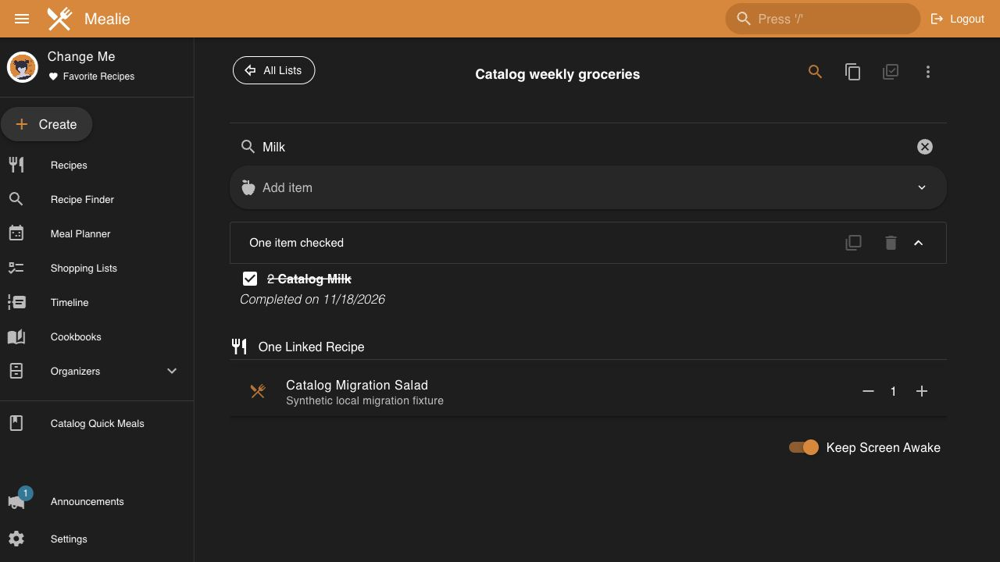
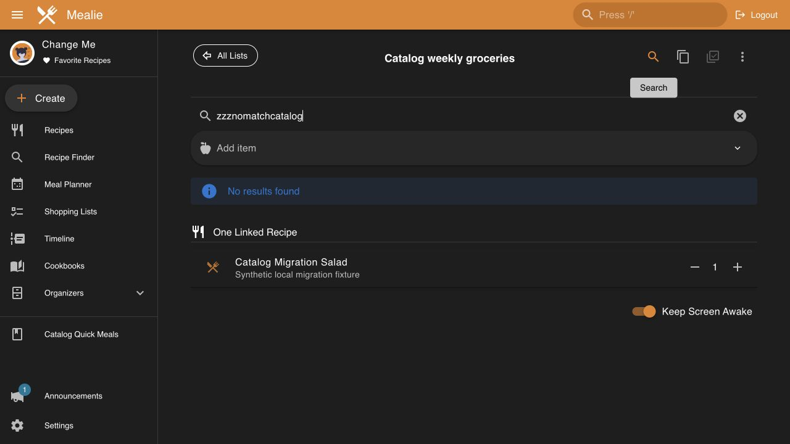
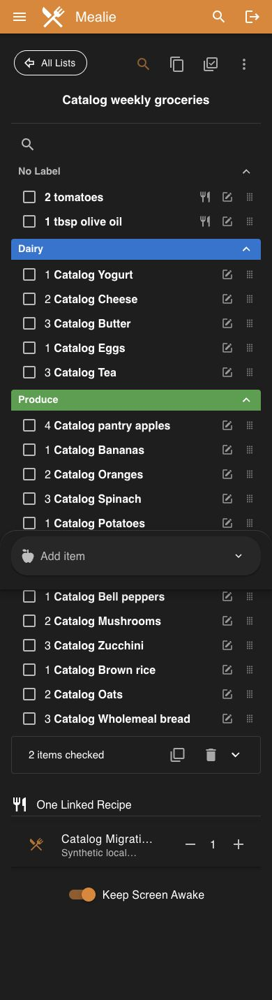
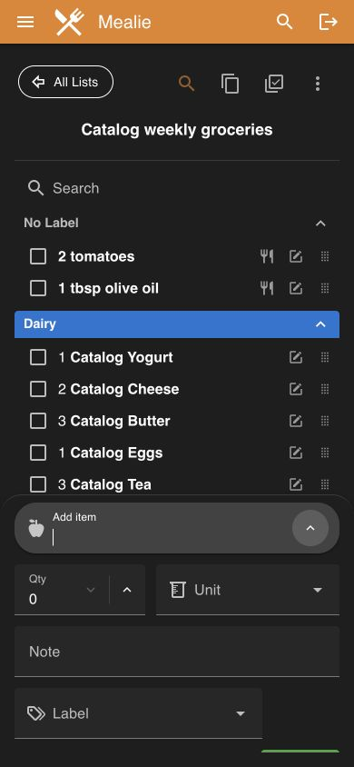
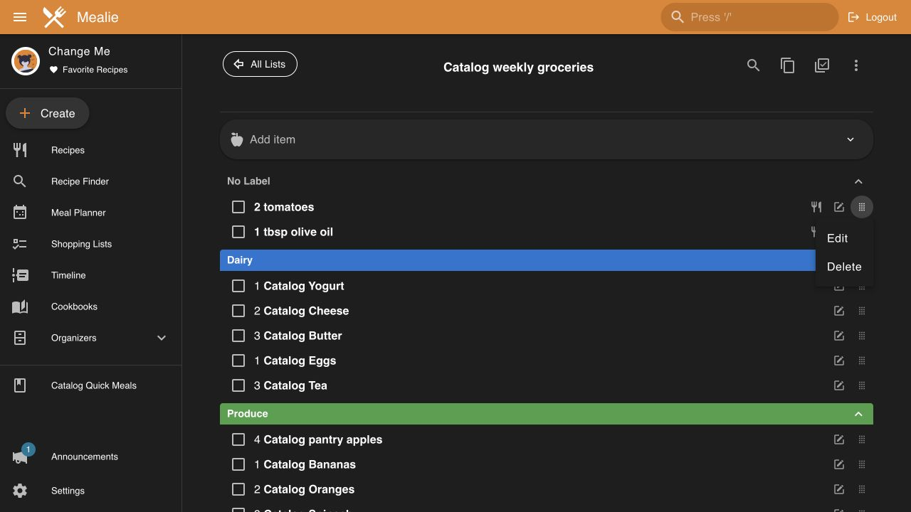
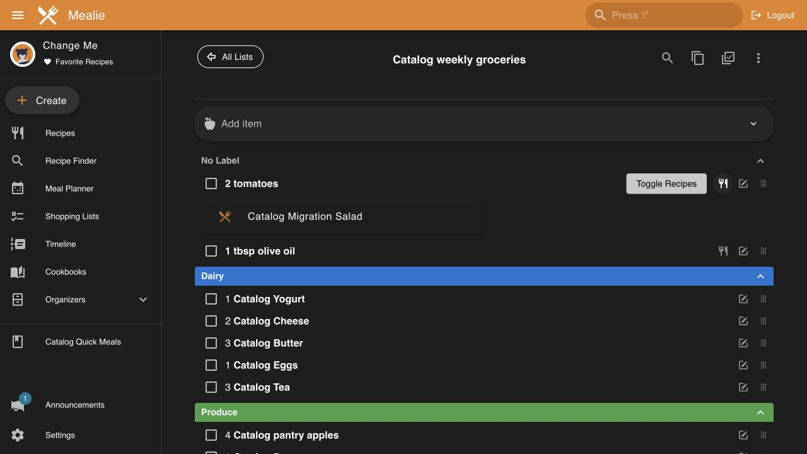
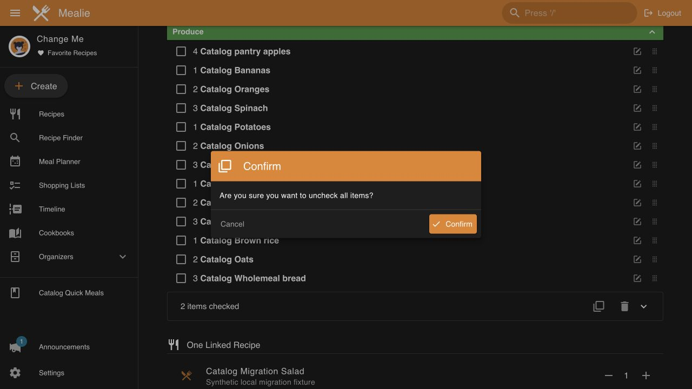
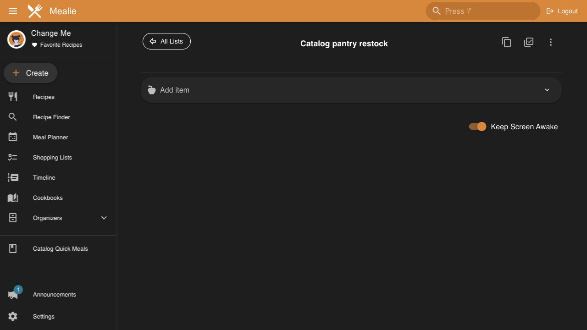
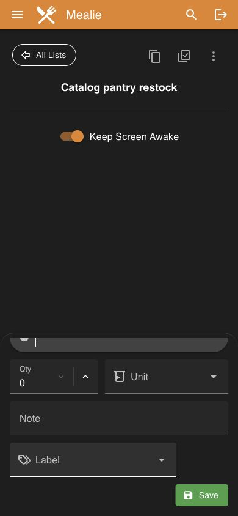

The mobile drawer's Save button clipped below the 390×844 viewport in the baseline. Fixed in the redesign: the docked add bar scrolls internally and Save stayed visible at 375×812.

## Migration validation

- [ ] Exercise the offline banner with network controls in an isolated test session.
- [ ] Verify queued create/update/delete, reconnect conflicts, failed-write retries, touch/RTL swipe, and keyboard reorder during replacement.
- [ ] Verify exact-match/new-food/unit creation, Save Label, reference quantity changes, and clipboard output during replacement.

## Shadcn Vue replacement checklist

- [x] Use Accordion, Checkbox, Combobox/Command, Input/Textarea, Dialog/Sheet, DropdownMenu, sortable rows, Toast with Undo, and Switch.
- [x] Preserve quick add, full item editor, mobile drawer, labels, recipe attribution, search, clipboard formats, and bulk reviews.
- [ ] Preserve optimistic queue semantics, offline feedback, poll lifecycle, touch/RTL behavior, and wake-lock lifecycle.
