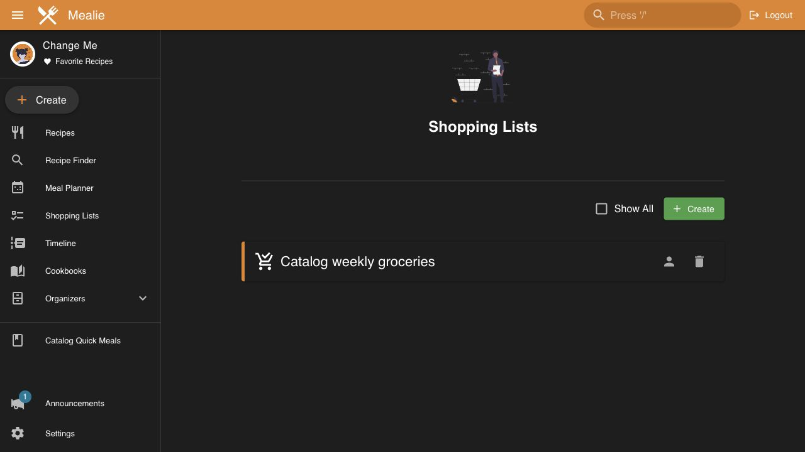
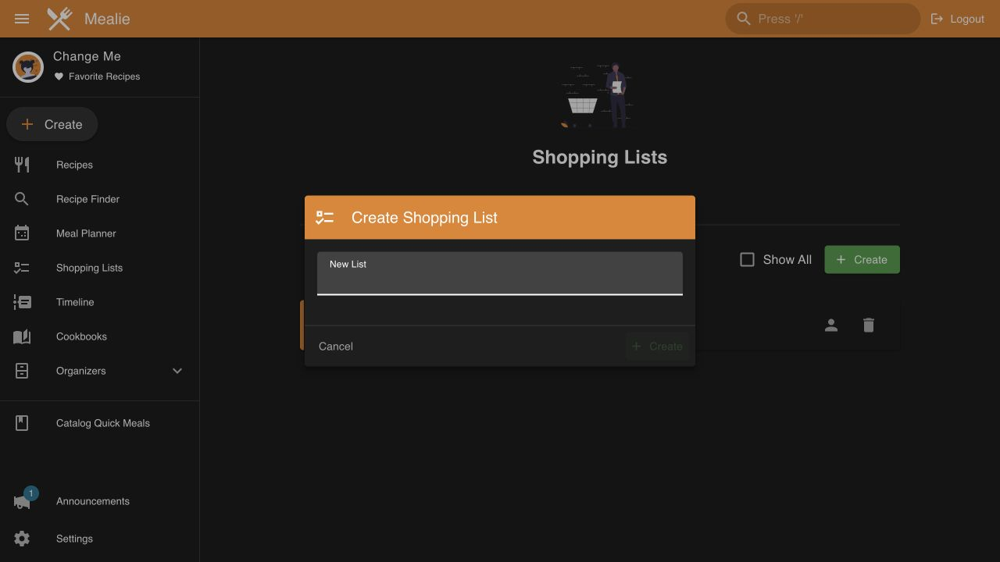
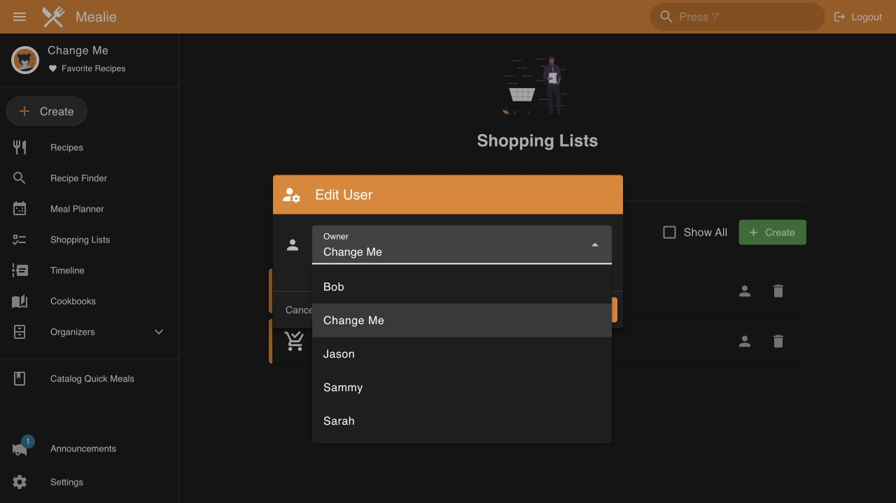
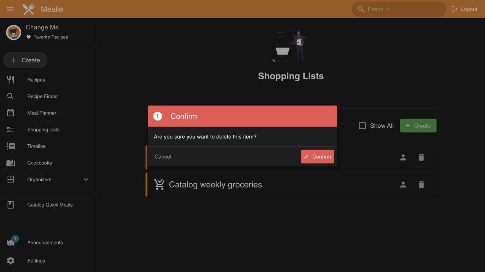

# Shopping-list overview

Route: `/shopping-lists`. Source: [index.vue](../../frontend/app/pages/shopping-lists/index.vue).

## Functions

- Require authentication. Fetch every accessible list in name order, ascending.
- Show All toggles a persisted preference. When off, show only lists whose userId matches the current user.
- Show the empty-list message when no choices remain. Click a list card to open its detail page.
- Automatically open the only available list unless disableRedirect=true appears in the query.
- Changing Show All disables automatic redirect for the current visit. Keep that watcher ahead of the redirect watcher.
- Create opens a bottom sheet with autofocus New List text. Trim its value and disable Create for an empty name.
- Successful creation refreshes choices and clears the name. Preserve BaseDialog submit and Enter behavior.
- Each card has Owner and Delete controls. Prevent those actions from following the card link.
- Owner opens Edit User with household members sorted by full name and the existing owner selected.
- Confirm ignores missing targets, missing selected users, and unchanged owners.
- Fetch the complete list before changing userId. Preserve its items and remaining fields in the update payload.
- Successful owner update refreshes choices. A list can disappear from the current-user filter after reassignment.
- Delete opens an explicit confirmation. Confirm deletes the target and refreshes choices; Cancel retains it.
- No list deletion or ownership change was confirmed in these captures.

## Redesign (implemented)

| Before | Now |
| --- | --- |
| Page title with a large cart illustration and a divider. | Plain "Shopping Lists" heading with a New List button beside it. |
| "Show All" checkbox. | "Show everyone's lists" switch. |
| List cards with separate Owner and Delete icon buttons. | Each list is a row (cart icon, name, "Someone else's list" when it isn't yours, chevron) with a "…" menu holding Change owner and Delete. |
| Delete asked "Are you sure you want to delete this item?". | Delete names the list and says it can't be undone. |
| "No Shopping Lists Found" as a page title. | An empty state that explains there are no lists yet, with a New List button. |
| Create and owner dialogs were bottom sheets. | They use the standard dialog (full-screen on phones). |

## Screenshots

## Migration validation and optional evidence

These additional cases remain for replacement validation. See the [handoff evidence decisions](../HANDOFF.md#evidence-decisions) for shared references, preview fixtures, and unexecuted branches.

- [ ] Capture Show All with another owner's list, filtered empty state, and mobile overview.
- [ ] Verify single-list redirect, owner-item preservation, and failure recovery during replacement.

## Shadcn Vue replacement checklist

- [x] Use linked Cards, Checkbox, Buttons, Dialog/Sheet, Input, and owner Select.
- [x] Preserve current-user filtering, redirect override, name validation, full-list owner updates, and deletion review.
