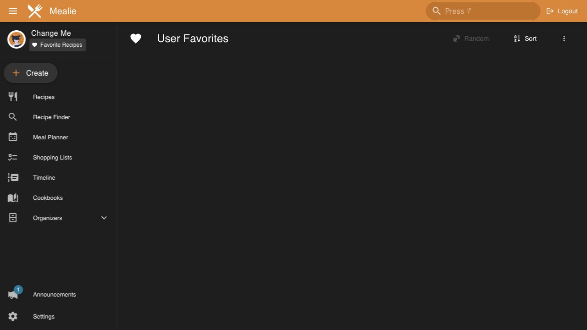
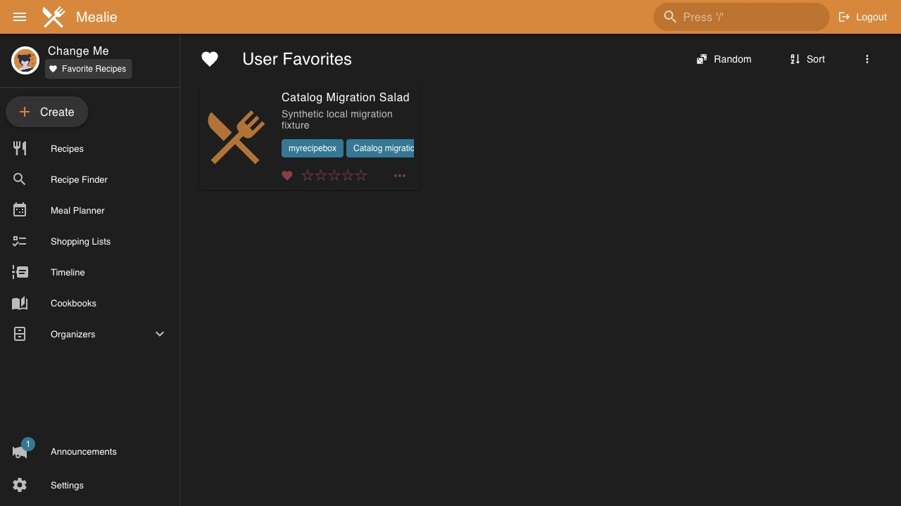
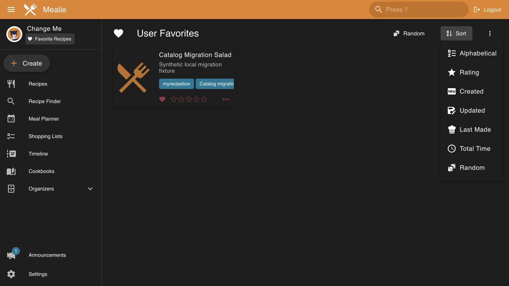

# User favorites

Route: `/user/:id/favorites`. Source: [favorites.vue](../../frontend/app/pages/user/[id]/favorites.vue).

## Functions to preserve

- Require authentication; set localized Favorites browser title and User Favorites section title with heart icon.
- Build the recipe query filter `favoritedBy.id = "{routeUserId}"`. This can be another user ID; do not silently substitute the session user's favorites. Backend access rules still apply.
- Render only for own-group context (routes without groupSlug treat logged-in state as own group).
- Apply the complete [shared recipe-card section contract](../shared-recipe-cards.md): sort including Last Made, direction toggling, seeded Random, compact toggle/mobile list, infinite paging, restored scroll position, card links, favorites, ratings, and tags.
- Apply every enabled [card context action](../shared-recipe-actions.md): downloads, meal planning, shopping lists, and sharing. Edit/Delete/Print are not enabled on these cards.
- Route wrapper wires recipe replace/append/sort/remove handlers; shared card section actually emits replace/append/itemSelected. Its tag event is not handled on this page, so chips do not apply explorer filters here.
- Empty favorites retain the toolbar with disabled Random and no dedicated empty-results message.
- Removing a favorite refreshes shared rating/favorite state but does not explicitly refetch this page's query; verify immediate removal from the list versus refresh behavior during migration.

## Screenshots

### Empty and populated favorites

Catalog Migration Salad was favorited through its card; the populated view confirms the complete explorer-to-favorites path.

### Shared section sort choices

## Migration validation and optional evidence

These additional cases remain for replacement validation. See the [handoff evidence decisions](../HANDOFF.md#evidence-decisions) for shared references, preview fixtures, and unexecuted branches.

- [ ] Verify another user's permitted favorites, removal refresh, paging/scroll restoration, and mobile view.
- [ ] Reuse the shared card/menu state audit; do not treat this route's wrapper as the full functionality.

## Shadcn Vue replacement checklist

- [ ] Apply all shared card and action tasks, preserving route-user filter, own-group condition, and empty/random state.
- [ ] Verify add/remove favorites across explorer, detail, profile, and this list without losing user-specific ratings.
