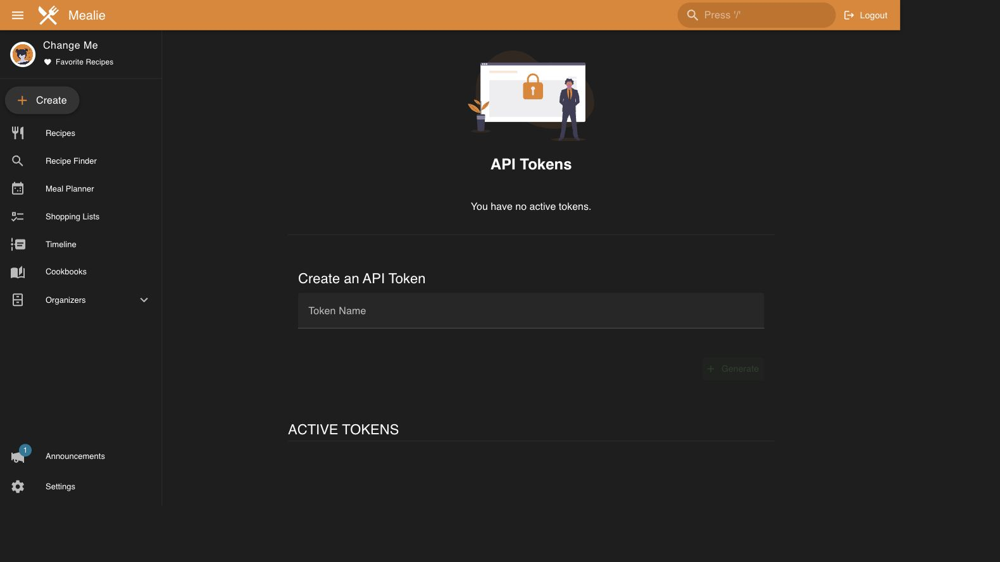
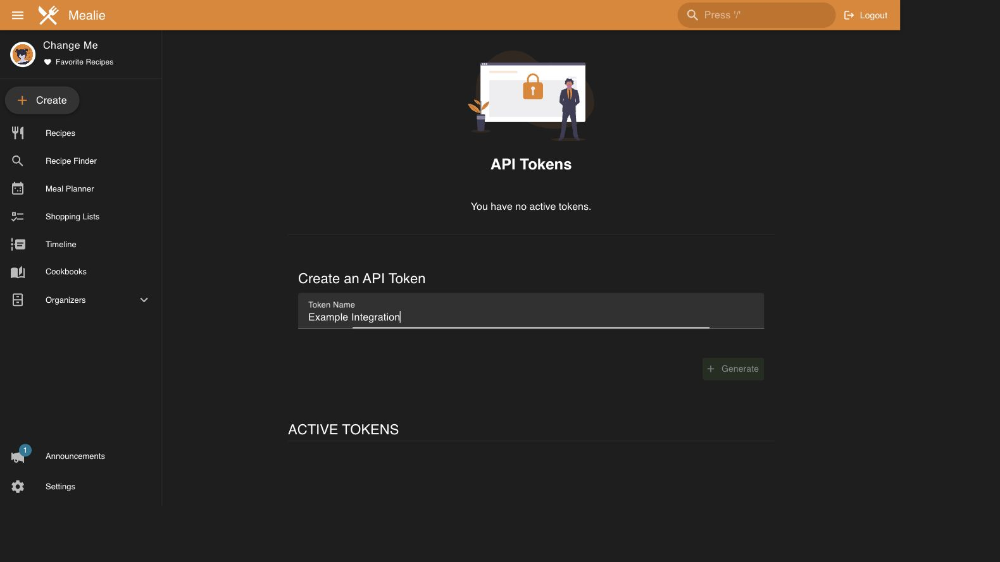
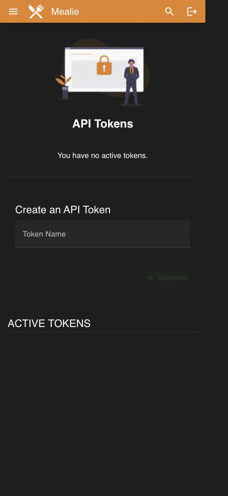
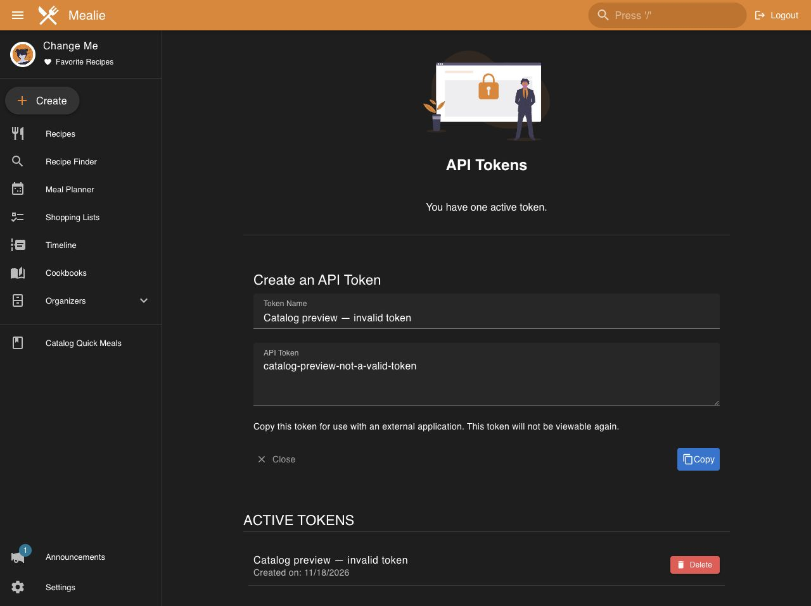
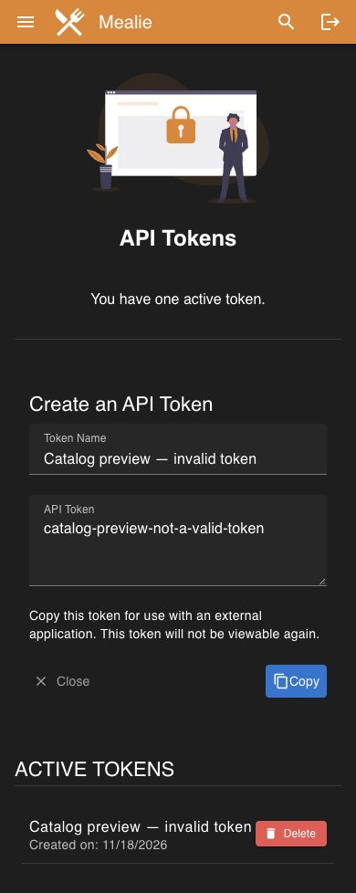

# API tokens

Route: `/user/profile/api-tokens`.
Source: [api-tokens.vue](../../frontend/app/pages/user/profile/api-tokens.vue).
Access: `auth` and `advanced-only` middleware. Layout: [shared shell](../shared-shell.md).
Status: source contract and visual references reviewed; runtime validation remains in the checklists below.

## Functions to preserve

- Display the active-token count from the authenticated user's token list.
- Enter a Token Name.
- Disable Generate when the name is empty.
- Generate a token with `api.users.createAPIToken({ name })`.
- After creation, show the returned token in a read-only multiline field.
- Explain that the token is visible only at creation and must be copied for external use.
- Replace Generate with Copy and Close while a created token is visible.
- Copy the full token to the clipboard.
- Close clears the visible secret, name, and local loading state, then refreshes the session.
- List each active token by name and localized creation date.
- Delete an active token by its ID and refresh the session afterward.
- Keep the no-active-token state usable and retain access to the creation form.

Current-source audit notes:

- The component has a loading guard but does not bind it to a visible loading indicator.
- A second Generate action while that flag is set resets the creation view.
- The page deletes immediately; it has no confirmation dialog in this source.
- The template's name gate checks an empty string, not a trimmed string.
- Do not expose an existing token value in the active-token list during the rewrite.

## Redesign (implemented)

| Before | Now |
| --- | --- |
| Illustration title; a card with the name field, Generate button and a textarea for the new token. | Plain heading; a "Create an API token" panel with the name and Generate on one row. Once generated, a marigold note says it won't be shown again, the token sits in a read-only field, with Done and Copy. |
| Tokens as a Vuetify list with dividers and Delete buttons. | A bordered list with the token name, created date and a trash button; an empty state when there are none. |

## Screenshots

### Empty token list and disabled Generate

### Named token form with Generate available

### Narrow-screen page

### Result and populated-list previews

These two images render the existing component with an explicitly invalid local initializer and a synthetic list row. No credential was generated or persisted. The isolated-checkout initializer was restored using [the preview helper](../scripts/token-preview-fixture.mjs). Close was exercised: it cleared the visible value and name and restored disabled Generate. The synthetic row remains because it belongs to the preview initializer, not the refreshed server session. Generation, deletion, and authorization still require migration tests.

## Migration validation

- [ ] Verify the access gate when advanced content is disabled.
- [ ] Verify credential generation, copy, session refresh, and immediate deletion using a disposable account; exclude usable tokens from screenshots.

## Shadcn Vue replacement checklist

- [ ] Replace page title, card, form fields, read-only token display, buttons, list items, and dividers.
- [ ] Preserve one-time secret visibility and clear it when the result closes.
- [ ] Preserve token count, creation date, generation, clipboard copy, deletion, and session refresh.
- [ ] Keep API-token operations behind the existing authentication and advanced-content gates.
- [ ] Test that a previously created token never reappears as a secret after page reload.
