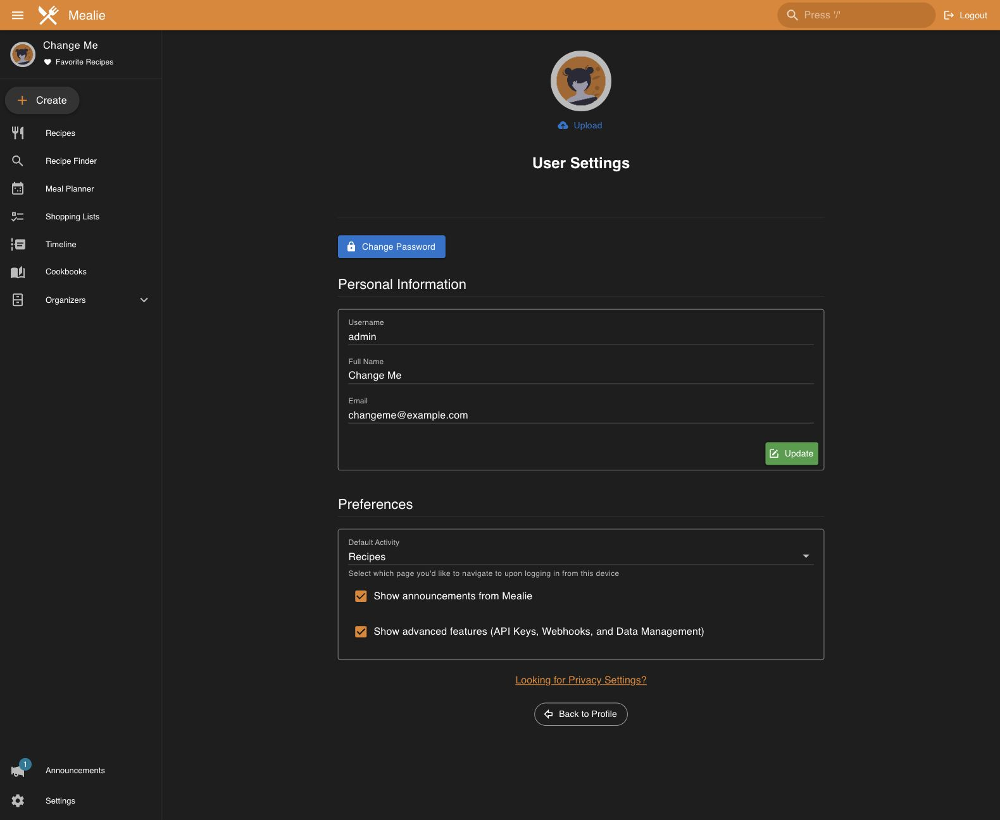
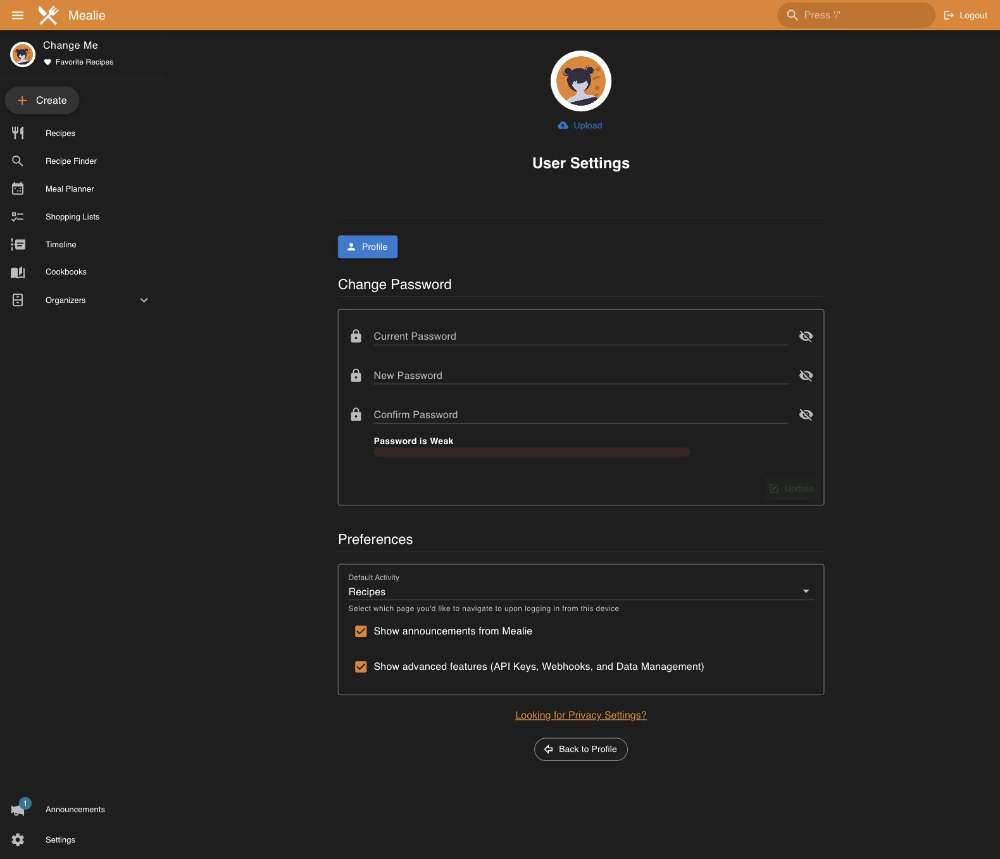
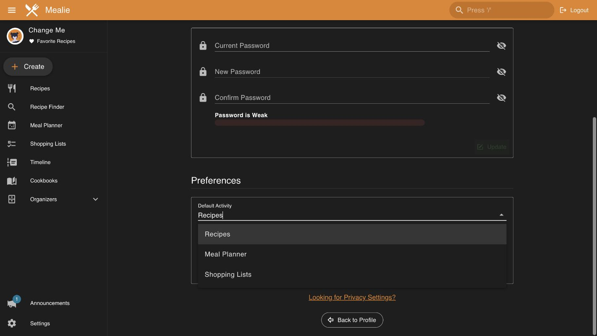
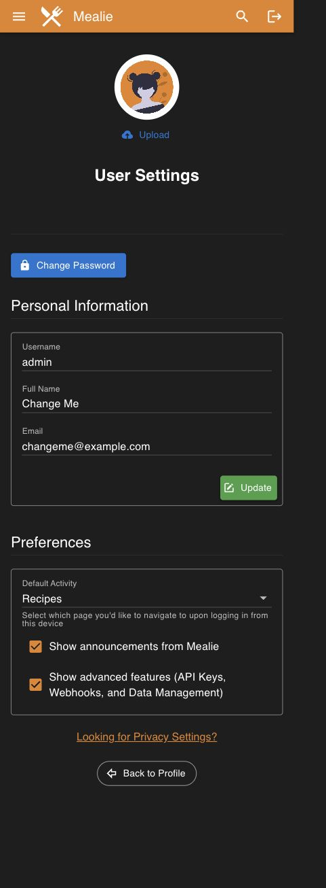

# User settings

Route: `/user/profile/edit`. Source: [edit.vue](../../frontend/app/pages/user/profile/edit.vue).
Access: authenticated users. Layout: [shared application shell](../shared-shell.md).
Status: source contract and visual references reviewed; runtime validation remains in the checklists below.

## Avatar

- Show the current avatar.
- Offer an image-only file chooser through Upload.
- Upload the file to `/api/users/{id}/image` with multipart field name `profile`.
- Show file-selection/upload progress and refresh the auth session after upload.
- Keep the current avatar until the upload result arrives.

Source: [AppButtonUpload.vue](../../frontend/app/components/global/AppButtonUpload.vue).

## Personal-information mode

- Edit Username, Full Name, and Email in a local copy of the session user.
- Show required semantics and blur-time validation. Email has explicit required and format rules.
- Update validates the personal-information form before the API call.
- Send the existing account permissions, group, household, authentication method, announcement choice, and advanced-content choice with the edited account fields.
- Do not silently drop those retained fields during a visual rewrite.
- Refresh the session on HTTP `200`, so the avatar/name/navigation consumers can refresh.
- Refresh the local user copy when the session user changes.

## Password mode

- Show Change Password only when password login is enabled.
- Toggle between Personal Information and Change Password without a route change.
- In password mode, the toggle reads Profile and restores the personal-information panel.
- Show Current Password, New Password, and Confirm Password.
- A shared visibility switch shows or masks all three values.
- Show current-password minimum-length, new-password minimum-length of 8, and matching-confirmation rules.
- Show the shared password-strength label and progress bar.
- Enable Update only when the new passwords match and are nonempty.
- Submit `currentPassword` and `newPassword` through the user API.
- On HTTP `200`, explicitly sign out because the server invalidates the previous session.
- Do not reuse the old session after the password change.

Current-source audit note: `updatePassword()` does not explicitly validate the password form.
The disabled expression's `password.current.length < 0` condition can never be true.
Record any stronger validation as an explicit behavior improvement; do not assume the current button fully validates the form.

## Preferences and links

- Select Default Activity from Recipes, Meal Planner, or Shopping Lists.
- Store the activity preference for this device through `useUserActivityPreferences`.
- Default unrecognized activity labels to Recipes.
- Toggle Show announcements from Mealie and Show advanced features.
- Each checkbox calls the user-update flow immediately, including its personal-form validation.
- Keep preferences visible in both personal-information and password modes.
- Link Looking for Privacy Settings? to `/group`.
- Link Back to Profile to `/user/profile`.

Sources: [activity preferences](../../frontend/app/composables/use-users/preferences.ts),
[activity registry](../../frontend/app/composables/use-default-activity.ts),
[password strength](../../frontend/app/components/Domain/User/UserPasswordStrength.vue).

## Screenshots

### Personal fields, avatar upload, preferences, and links

### Password panel and retained preferences

### Default-activity choices

### Narrow-screen form and preferences, 390 pixels wide

## Migration validation and optional evidence

These additional cases remain for replacement validation. See the [handoff evidence decisions](../HANDOFF.md#evidence-decisions) for shared references, preview fixtures, and unexecuted branches.

- [ ] Capture invalid personal email, upload progress/result, and preference persistence with disposable data.
- [ ] Capture password-login-disabled visibility.
- [ ] Verify the password-change result with a disposable fixture.

## Shadcn Vue replacement checklist

- [ ] Replace fields, checkbox controls, combobox, buttons, cards, section headings, and panel transitions.
- [ ] Preserve avatar upload, multipart field name, and session refresh.
- [ ] Preserve the distinction between device activity preferences and server account settings.
- [ ] Preserve mode switching and post-password-change sign-out.
- [ ] Preserve retained account fields when constructing update payloads.
- [ ] Verify keyboard access, validation messages, password-toggle names, and mobile layout.
