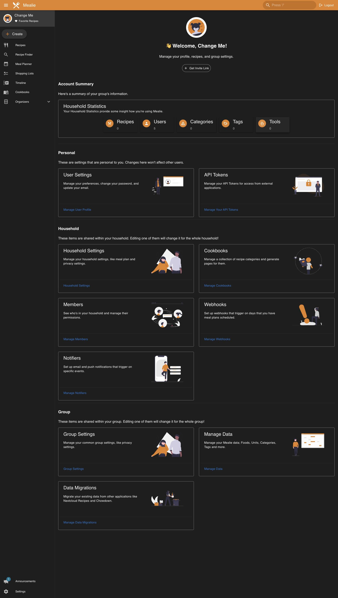
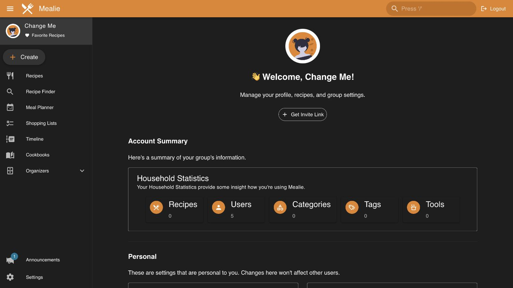
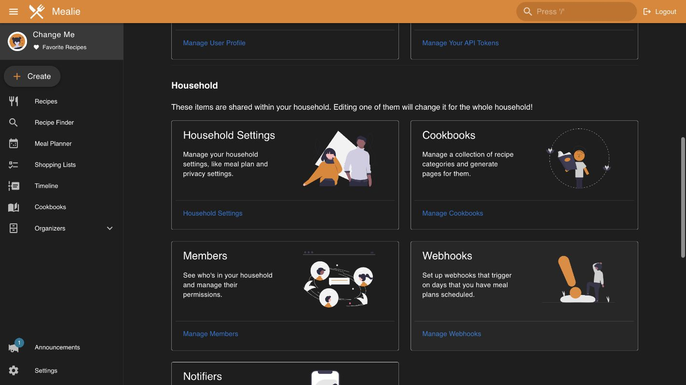
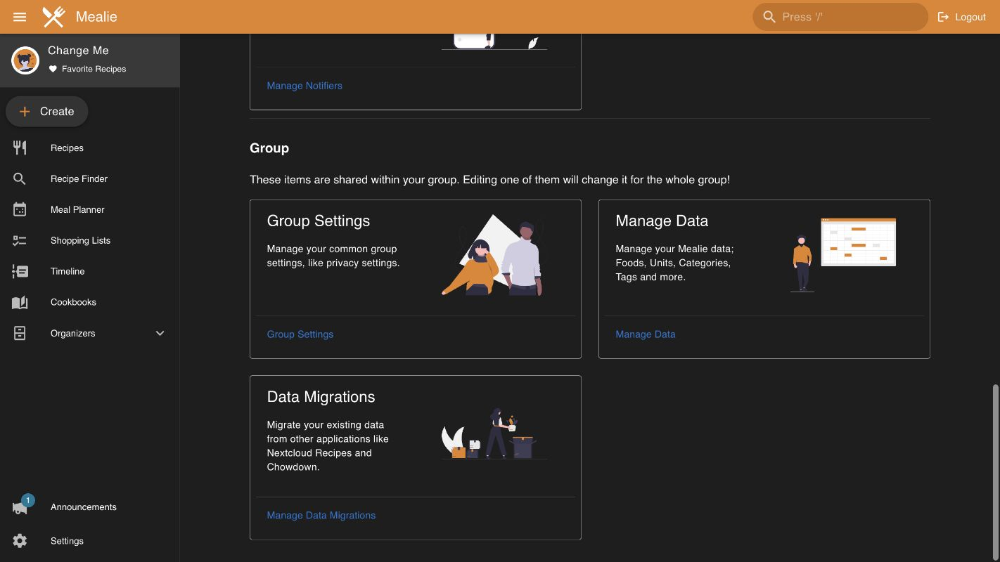
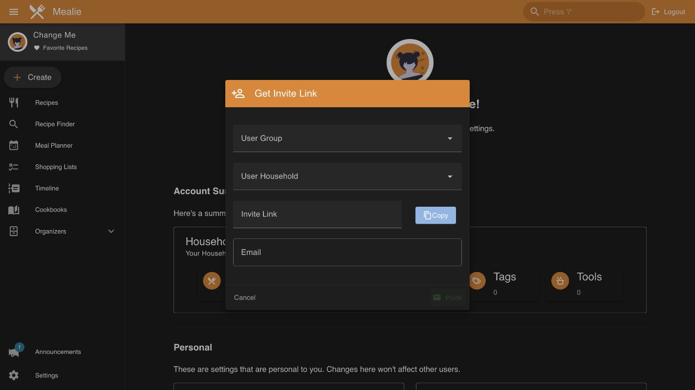
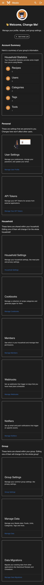
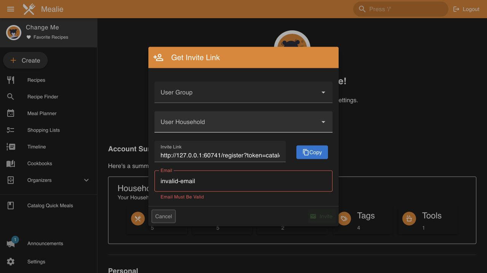

# Profile home

Route: `/user/profile`. Source: [profile/index.vue](../../frontend/app/pages/user/profile/index.vue).
Access: authenticated users. Layout: default application shell; see [shared shell](../shared-shell.md).
Status: source contract and visual references reviewed; runtime validation remains in the checklists below.

## Functions to preserve

- Display the user's avatar, full name, welcome message, and account-summary description.
- Open Get Invite Link when `canInvite` is true and password login is enabled.
- Hide invitation access when the instance disables password login, even if the account has invitation permission.
- Fetch household statistics and display recipe, user, category, tag, and tool counts as destination links.
- Hide the user count when the user lacks `canManage`.
- Link recipe count to the current group, user count to household members, and organizer counts to their group browsers.
- Use the route group slug when present, otherwise the authenticated user's group slug.
- Stack the statistic cards at the smallest display size.
- Separate personal settings from household-shared and group-shared settings and retain each explanation.

## Destination cards and permissions

| Section | Destination | Visibility |
| --- | --- | --- |
| Personal | User Settings → `/user/profile/edit` | Authenticated users |
| Personal | API Tokens → `/user/profile/api-tokens` | Advanced content enabled |
| Household | Household Settings → `/household` | `canManageHousehold` |
| Household | Cookbooks → group cookbook list | Authenticated users |
| Household | Members → `/household/members` | `canManage` |
| Household | Webhooks → `/household/webhooks` | Advanced content and `canManageHousehold` |
| Household | Notifiers → `/household/notifiers` | Advanced content and `canManageHousehold` |
| Group | Group Settings → `/group` | `canManage` |
| Group | Manage Data → `/group/data/foods` | `canOrganize` |
| Group | Data Migrations → `/group/migrations` | Advanced content |

Hide the entire Group section unless the user can manage, can organize, or has advanced content enabled.
Retain the title, explanation, image, and action link on each card.

## Invitation dialog

Source: [UserInviteDialog.vue](../../frontend/app/components/Domain/User/UserInviteDialog.vue).

- For administrators, load group and household choices.
- Filter households to the selected group.
- Generate a one-use invitation when both administrator selections exist.
- For non-administrators, request a one-use invitation for the current household when the dialog opens.
- Construct the registration URL from the current browser origin and invitation token.
- Show the URL as read-only and provide Copy.
- Provide an email field with format validation.
- Disable Invite while email is blank or invalid. Support Enter in the email field.
- Show invitation-send progress, then success or failure feedback, and close the dialog after the response.
- Cancel closes without an email request.
- Keep invitation tokens out of reusable design fixtures. Use revoked or clearly fake examples for token-result captures.

## Screenshots

### Complete page

### Header, statistics, and personal settings

### Household destinations

### Group destinations

### Administrator invitation form before group selection

The result uses an invalid invitation initializer in the isolated checkout, restored with [the preview helper](../scripts/link-preview-fixture.mjs). No invitation was generated or emailed.

## Migration validation and optional evidence

These additional cases remain for replacement validation. See the [handoff evidence decisions](../HANDOFF.md#evidence-decisions) for shared references, preview fixtures, and unexecuted branches.

- [ ] Verify invitation group/household selection and server/email behavior; the fake link and email validation preview are captured above.
- [ ] Capture a limited-permission account and advanced content disabled.
- [ ] Verify responsive cards after replacement against the mobile reference above.

## Shadcn Vue replacement checklist

- [ ] Replace statistic cards, link cards, avatar presentation, grid, separators, and invitation dialog controls.
- [ ] Preserve every destination and visibility rule in the table.
- [ ] Keep group and household context in all links and invitation requests.
- [ ] Make cards and statistics keyboard-accessible links with clear names.
- [ ] Preserve clipboard and email-invitation behavior with accessible success/error feedback.
