# Shared layouts and cross-page controls

These controls apply to every page that uses the matching layout.
Read this document with each page specification. Page screenshots do not replace this shared behavior contract.
Status: source reviewed; navigation, menus, empty/populated/keyboard search, announcements, and mobile captures complete.

## Layouts

| Layout | Shared functions |
| --- | --- |
| [default](../frontend/app/layouts/default.vue) and [DefaultLayout](../frontend/app/components/Layout/DefaultLayout.vue) | Header, responsive sidebar, recipe-create menu, cookbook links, page content, global toasts. |
| [admin](../frontend/app/layouts/admin.vue) | Header, responsive sidebar, admin and developer links, page content, global toasts. |
| [basic](../frontend/app/layouts/basic.vue) | Header home/branding link without the normal search/login menu; global toasts. |
| [blank](../frontend/app/layouts/blank.vue) | Page content, global toasts, demo-instance notice when enabled. |

The default, basic, and admin layouts initialize global localization.
Retain the app-level theme, branding name/logo, translated labels, and print exclusions.
Default and admin sidebars start open at `lgAndUp`; smaller screens start closed.
The menu button changes drawer visibility. Retain overlay dismissal, keyboard access, and the drawer's touchless behavior decision.

## Header

Source: [AppHeader.vue](../frontend/app/components/Layout/LayoutParts/AppHeader.vue).

- Link the logo and branding name to the route group, session group, or `/` fallback.
- Use the configured branding logo when available; otherwise show the default icon.
- Show a search field on larger screens and a search icon at the smallest breakpoint.
- Both search controls open the same recipe-search dialog.
- The `/` key opens search unless an INPUT or TEXTAREA has focus.
- Install the shortcut listener on mount and remove it on unmount.
- Show Logout for an authenticated user; show Login for a public visitor.
- On narrow screens, present Logout as an icon action.
- Logout ends the session and goes to `/login?direct=1` to avoid immediate automatic sign-in.
- Hide the header for print output.

## Sidebar and default navigation

Source: [AppSidebar.vue](../frontend/app/components/Layout/LayoutParts/AppSidebar.vue).

- Show the authenticated user's avatar, full name, profile link, and own-group Favorite Recipes link.
- Keep the active route and expanded navigation groups visually distinct.
- Show Recipes and Recipe Finder as public group navigation.
- Limit Meal Planner, Shopping Lists, Timeline, Cookbooks, and Organizers to the user's own group context.
- Expand Organizers into Categories, Tags, and Tools.
- Show Create only in the user's own group.
- Create offers URL import and manual creation; include AI import only when the group enables AI.
- Load cookbook links from the authenticated store for the user's group or the public store for another group.
- Sort cookbooks by position.
- List the current household's cookbooks first.
- Group other households' cookbooks by household name and sort those groups by name.
- Honor the preference to hide other households' cookbooks.
- Preserve permission filtering on both primary and secondary links.

## Settings menu

- Open Language and its shared dialog.
- Toggle Light Mode or Dark Mode; show the action appropriate to the current theme.
- Show User Settings for authenticated users and link to `/user/profile`.
- Show Data Management for `canOrganize` users and link to `/group/data`.
- Show Admin Settings for administrators and link to `/admin/site-settings`.
- Preserve section separators and keyboard dismissal.

## Admin navigation

- Site Settings → `/admin/site-settings`.
- Users → `/admin/manage/users`.
- Households → `/admin/manage/households`.
- Groups → `/admin/manage/groups`.
- Backups → `/admin/backups`.
- Maintenance → `/admin/maintenance`.
- Expand Debug into AI Providers and Parser.
- Keep the existing admin route guards. A visible link is not an authorization boundary.
- Do not add the commented-out Analytics entry as a new function.

## Global recipe-search dialog

Source: [RecipeDialogSearch.vue](../frontend/app/components/Domain/Recipe/RecipeDialogSearch.vue),
[search composable](../frontend/app/composables/recipes/use-recipe-search.ts).

- Autofocus the search input and disable browser autocomplete for the query.
- Debounce query changes by 500 milliseconds.
- Request the first 20 results, sorted by name ascending, with a fresh search seed.
- Use the authenticated API in the user's own group; use the public explore API for another group.
- Show recipe cards with name, description, slug, rating, image, and recipe identity.
- Scroll the results list within its maximum height.
- Arrow Up and Arrow Down change the selected result and scroll it into view.
- Enter opens the selected result, or the first result if none is selected.
- Ignore composing-keyboard events so IME entry does not activate a recipe.
- In selection mode, return the recipe through the `selected` event instead of navigating.
- Close on route change. Clear query, results, and keyboard selection when the dialog closes.
- Add and remove the dialog keyboard listener with the open state and component lifecycle.
- Provide the explicit close icon on the smallest layout, as well as dialog dismissal.

Current-source audit note: the dialog owns a loading ref separately from the search composable's loading ref.
Do not assume the existing card-loading binding covers all search request progress.

## Announcements

Source: [AnnouncementDialog.vue](../frontend/app/components/Domain/Announcement/AnnouncementDialog.vue).

- Show the sidebar entry only for authenticated users with announcements enabled.
- Show the unread count badge when unread announcements exist.
- On first open, select the first unread announcement or the newest available announcement.
- Show titles and localized dates in reverse order in a scrollable navigation list.
- Mark an announcement read when the user selects it.
- Show the selected announcement's rendered content and date chip.
- On small screens, toggle the navigation list with All Announcements.
- Offer Mark All as Read when unread items remain.
- Next advances through unread announcements; disable it when none remain after the current item.
- Done closes the dialog. Route changes also close it.

## Global toasts and loading notices

Source: [TheSnackbar.vue](../frontend/app/components/Layout/LayoutParts/TheSnackbar.vue).

- Show error, success, and information messages with the appropriate icon and color.
- Preserve the message title, body, configurable timeout, and default two-second timeout.
- Close dismisses the message. If an action exists, its button runs the callback and then closes.
- Keep bottom loading notices independent of ordinary alerts.
- Loading notices have no automatic timeout, show an indeterminate bar, and support dismissal.
- Use accessible live announcements without moving focus away from the current task.

## Screenshots

### Settings menu and permission-aware destinations

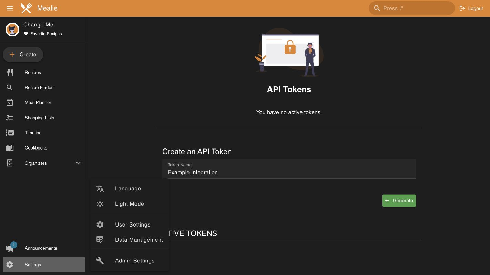

### Recipe-create menu

AI import is absent because the capture group has no AI provider enabled.

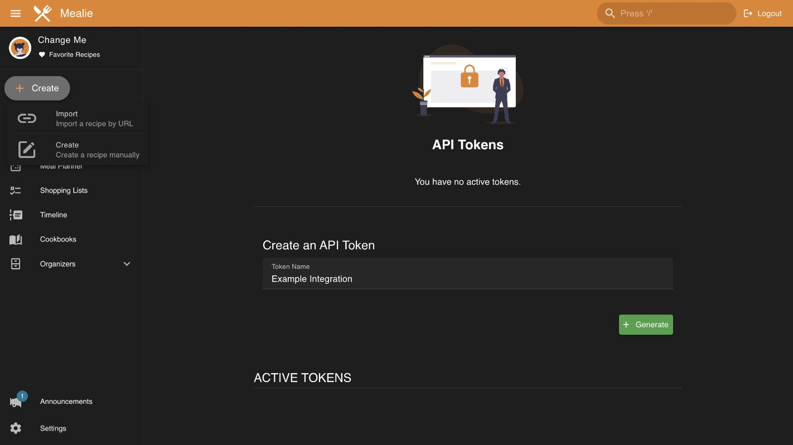

With a local AI provider fixture enabled, Create also offers AI import.

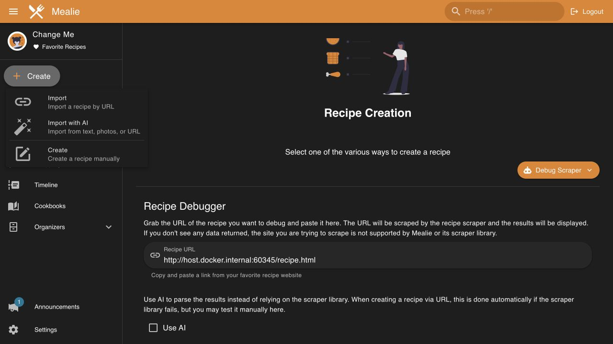

### Organizer group expanded

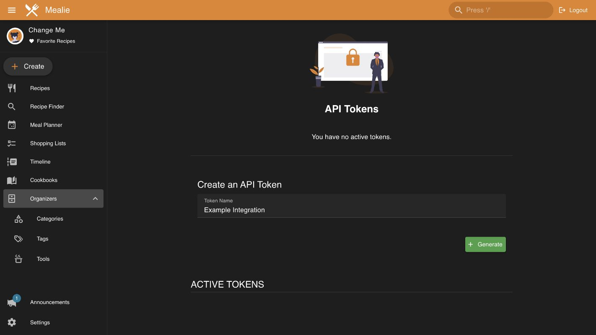

### Search dialog before a query

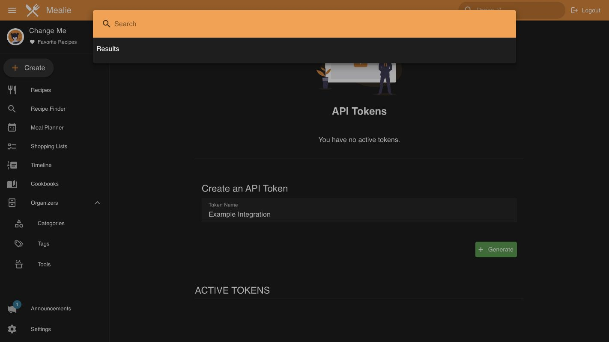

### Query with no matches

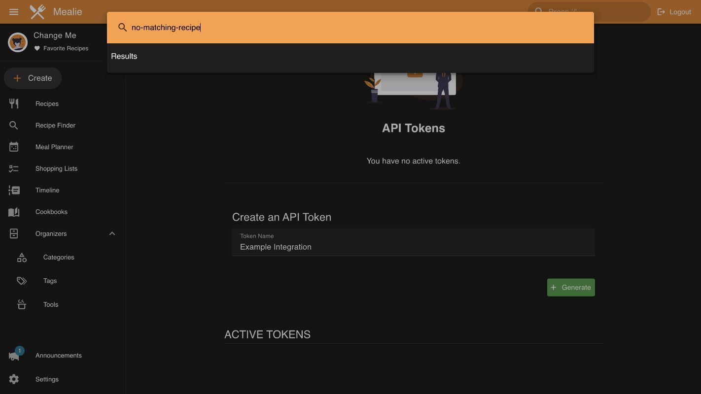

### Mobile header and closed drawer, 390 × 844

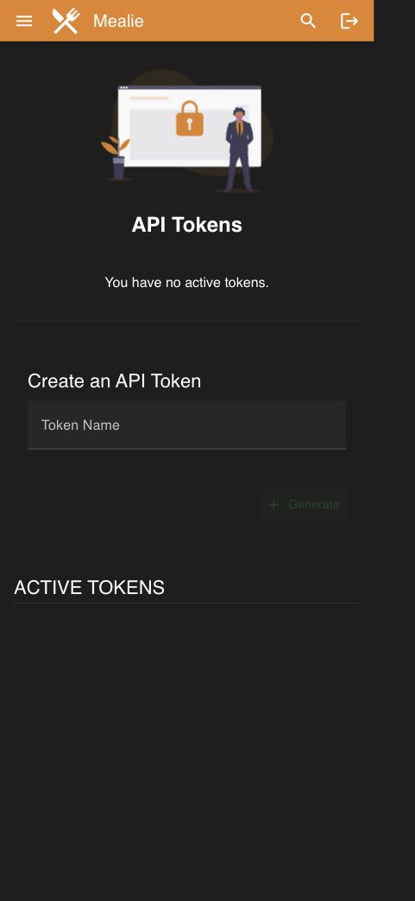

### Mobile drawer open

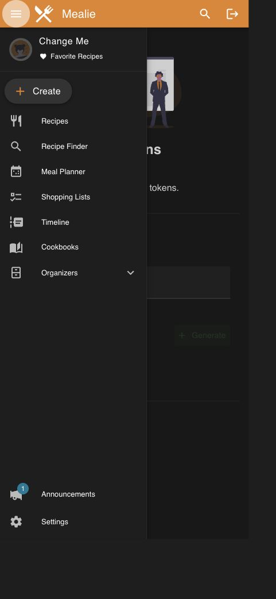

### Mobile search

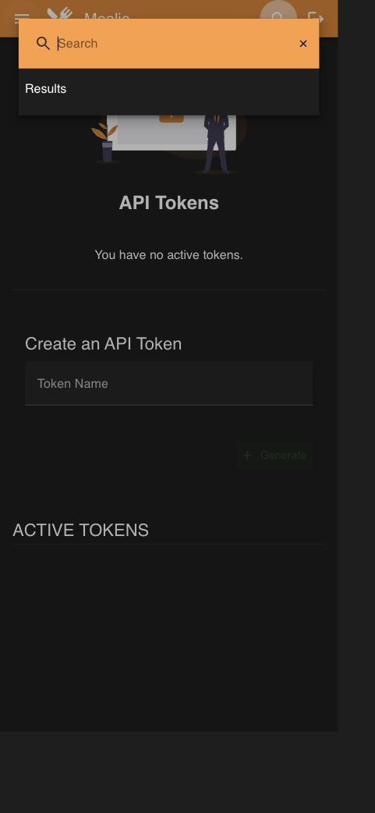

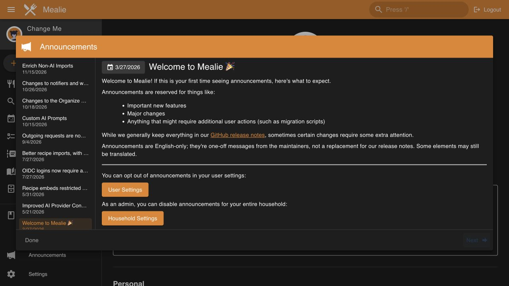
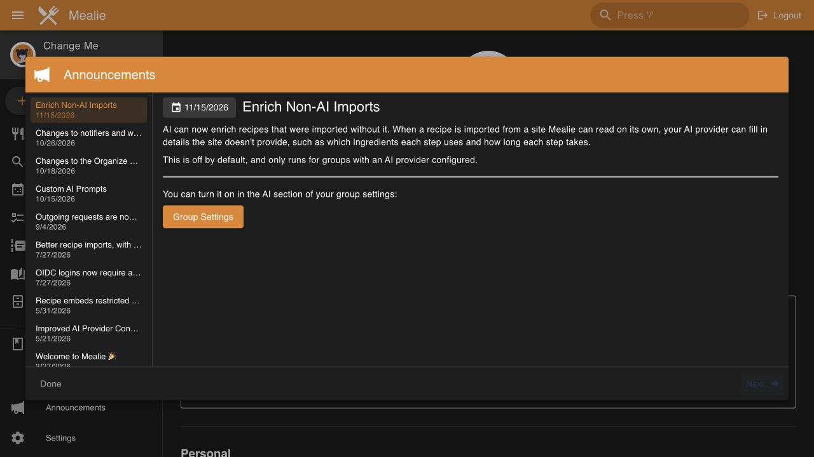
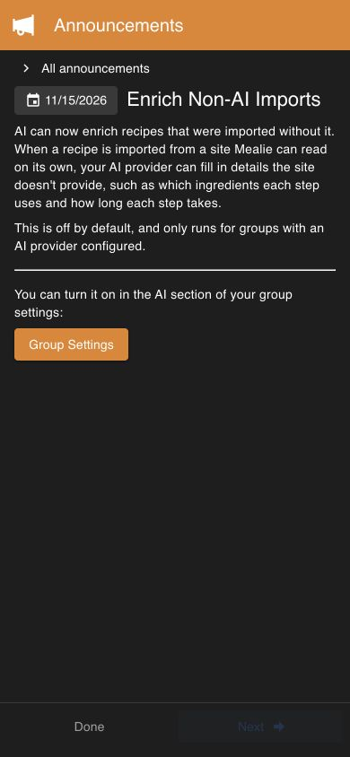
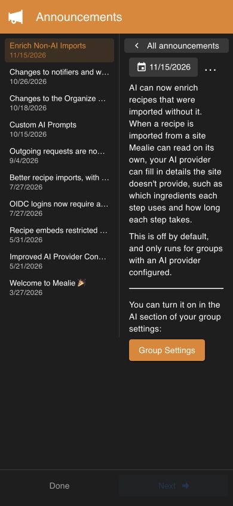
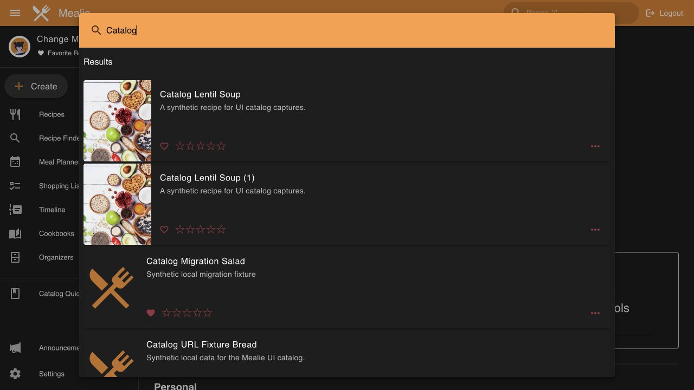
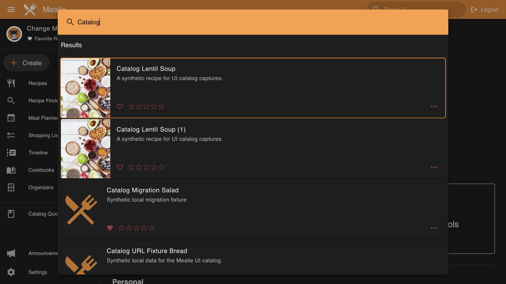

Opening the sole unread welcome announcement marked it read in the isolated fixture. The captures show disabled Next after unread items are exhausted. Source rules above cover Mark All as Read and further unread navigation.

## Additional evidence required

- [ ] Capture populated search, keyboard selection, and selection-mode consumers.
- [ ] Capture cookbook navigation with another household and the hide preference.
- [ ] Capture announcements, unread controls, and its mobile navigation.
- [ ] Capture the admin sidebar and public/limited-permission shells.
- [ ] Capture light theme, branding overrides, and demo notices with local fixtures.

## Shadcn Vue replacement checklist

- [ ] Replace application bars and drawers with a responsive, accessible shell and Sidebar/Sheet controls.
- [ ] Replace menus, lists, badges, dividers, dialogs, fields, and progress indicators.
- [ ] Use Command/Dialog primitives for search while retaining all query, keyboard, and selection behavior.
- [ ] Replace Snackbar with the shared toast implementation, including action callbacks and independent progress notices.
- [ ] Replace Vuetify display/theme APIs, injected `$vuetify`, utility classes, and print-specific assumptions.
- [ ] Preserve route context, public/own-group distinctions, role filtering, theme state, and locale state.
- [ ] Add accessible names to icon-only controls and retain focus restoration and Escape behavior.
